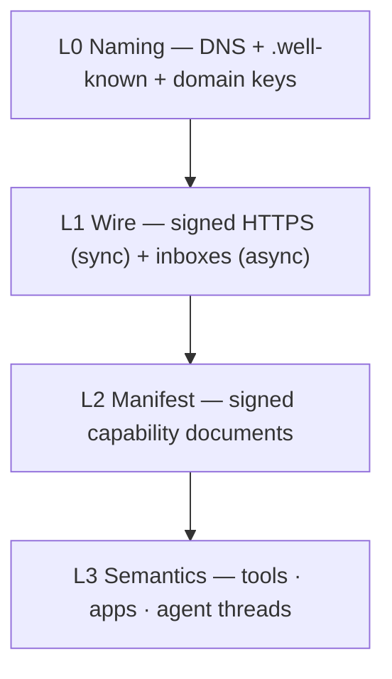

# AWP — Agent Web Protocol

An open protocol for an internet of AI agents: agent-to-agent communication and
publishing capabilities (tools, apps, agents) for other agents to discover and
consume. Federated by design — anyone hosts, names resolve through DNS, no
central registry, no new PKI.

## Design decisions (ratified)

| Decision            | Choice                                                        |
|---------------------|---------------------------------------------------------------|
| Shape               | Open protocol + Go reference platform (`awpd`)                |
| Primitives          | Layered: tools (sync), apps (sessions), agents (async A2A)    |
| Discovery / trust   | Federated, DNS-anchored; crawlable format, competitive indexes|
| Identity            | Domain-anchored Ed25519 keys, DKIM-style, rotation chains     |
| Economics           | Deferred; `pricing` field reserved (`null` in v0.1)           |
| Transport           | Sync signed HTTPS for tools; async signed inboxes for A2A     |
| Publishing artifact | Signed manifest; hosted endpoint and/or portable WASM         |
| Session state       | Negotiated per-entity in manifest (`stateless`/`provider`/`caller`) |
| Oversight           | Minimal: request signing + delegation proofs; content trust is the client's problem |

## Layer model

```
L3  Semantics   tools · apps · agent threads
L2  Manifest    signed capability documents
L1  Wire        signed HTTPS (sync) + inboxes (async)
L0  Naming      DNS + .well-known + domain keys
```



## Documents

| File                       | Status | Scope                                        |
|----------------------------|--------|----------------------------------------------|
| `spec/awp-core-v0.1.md`    | Draft  | Normative protocol: L0–L3                    |
| `spec/awp-sig-v0.1.md`     | Draft  | Normative sync signing profile (RFC 9421)    |
| `spec/awp-discovery-v0.1.md` | Strawman | Index query/submission schema (post-M1 validation) |
| `spec/awp-quic-v0.1.md`    | Draft  | Optional `awp/1` QUIC binding + `awp://` scheme |
| `spec/awpd-store-v0.1.md`  | Draft  | `awpd` only: persistence layout (bbolt)      |
| `spec/awpd-outbox-v0.1.md` | Draft  | `awpd` only: delivery retry state machine    |

The two `awpd-*` documents are implementation specs for the reference daemon.
They are NOT normative for the protocol; alternative implementations may
persist and retry however they like as long as the observable wire behavior
in `awp-core` and `awp-sig` holds.

## Reference implementation

`awpd` — single Go binary: serves the domain index and inbox, runs hosted
tools, and executes portable (wasm32-wasip1) entities on
[wazero](https://github.com/tetratelabs/wazero). `awp` is a small CLI for
black-box conformance testing (`awp conformance <domain>`) and local outbox
inspection (`awp outbox ls -dead`) — it is not how you send messages or call
tools programmatically; that's `sdk/go`, a thin client for third-party Go
programs to speak AWP directly (sign, send, call) without running a daemon.
First milestone (tagged `v0.1.0-m1`): two instances completing a signed
`message → ack → reply → close` thread on localhost — see
`examples/agent-messaging` for exactly that, running.

## Documentation

| Doc | Covers |
|---|---|
| [`docs/getting-started.md`](docs/getting-started.md) | Build it, run the first two examples, narrated. |
| [`docs/protocol-overview.md`](docs/protocol-overview.md) | The concepts — domains, manifests, sessions, delegation, envelopes — in plain English, linked to the normative spec. |
| [`docs/agent-guide.md`](docs/agent-guide.md) | **For AI agents/agent builders**: what's safe to feed a model, tool discovery, delegation, and what it actually takes to be a callable agent, not just a caller. |
| [`docs/architecture.md`](docs/architecture.md) | How the `internal/*` packages implement the protocol; system, process, and request-flow diagrams. |
| [`docs/sdk-go.md`](docs/sdk-go.md) | The `sdk/go` client API reference. |
| [`docs/cli-reference.md`](docs/cli-reference.md) | Every `awpd`/`awp` flag that actually exists. |
| [`docs/deployment.md`](docs/deployment.md) | Running a real domain: TLS, QUIC, retention, a two-domain checklist. |

## Examples

Five self-contained, runnable programs under [`examples/`](examples) — no
DNS, no real certificates, no setup beyond `go run`:
[`hello-tool`](examples/hello-tool),
[`stateful-tool-delegation`](examples/stateful-tool-delegation),
[`agent-messaging`](examples/agent-messaging),
[`custom-message-handler`](examples/custom-message-handler), and
[`portable-wasm-tool`](examples/portable-wasm-tool). Start with
[`examples/README.md`](examples/README.md).

[`agents/python/`](agents/python) is a different kind of example: two
real [Google ADK](https://github.com/google/adk-python) agents, in
Python (managed with `uv`), talking to each other over AWP — a from-scratch
`pyawp` implementation of the same signing/envelope/inbox logic the Go
code above implements, verified to actually interoperate with it (not
just with itself) in `agents/python/scripts/crosscheck_go.py`.

## v0.2 backlog (deliberately out of scope for v0.1)

Multiparty threads · store-and-forward relays · WASM component-model (WIT)
interface · pricing/settlement · standardized scope vocabulary ·
content-trust/provenance beyond sender authentication. (`awp/1` over QUIC
moved into v0.1 as an optional binding: `spec/awp-quic-v0.1.md`.)
