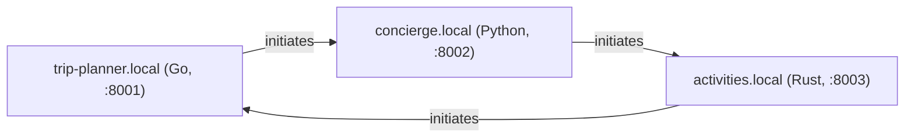

# trip-planner.local — a Go AWP agent, talking to Grok

`trip-planner.local` — one of three AWP agents (Go, Python, Rust) that
form a full triangle demo: every pair of agents talks directly over real
AWP (real Ed25519 signatures, real JCS (RFC 8785) canonicalization, real
signed HTTP envelopes), each one calling [xAI's Grok](https://x.ai) as
its LLM. This directory is the Go corner of that triangle; it imports this
module's own `internal/identity`, `internal/envelope`, and `sdk/go`
directly, so it is byte-for-byte the same signing/verification code the
rest of this repo uses — not a reimplementation.



Each node initiates exactly one outbound thread and receives on the other
edge — true all-to-all for three nodes, not a hub. This binary:

- **initiates** a thread with `concierge.local`, asking for a neighborhood
  and restaurant recommendation, and carries it forward for up to 3
  exchanges each way;
- **receives and replies** on the thread `activities.local` opens with it.

## Setup

```
cd agents/go
cp .env.example .env   # then fill in XAI_API_KEY
```

Get a key at <https://console.x.ai/>. Every agent turn is a real Grok
call — there is no offline/mock mode.

## Run

From `agents/go` (running from here, not the repo root, matters:
`.env` is loaded relative to the working directory):

```
cd agents/go
go run .
```

or build the binary directly:

```
go build -o /tmp/trip-planner ./agents/go
/tmp/trip-planner   # still needs to run with agents/go as its cwd for .env, or export the vars directly
```

Starts on `http://127.0.0.1:8001`, serves a signed index at
`/.well-known/awp.json`, sends the opening message to `concierge.local`
about 1 second after startup, and prints every send/receive to stdout as
`[from] -> [to] (turn N/max): text`. Running it standalone (nothing else
up on `:8002`/`:8003` yet) is expected to fail to *reach* its peers — the
opener send will error out, and no thread will ever land on the inbox —
but the process itself starts, serves its index, and does not crash; that
failure mode is exactly what running this corner of the triangle alone
looks like.

Override via env vars (or `.env`): `AWP_SELF_PORT`, `AWP_SELF_DOMAIN`,
`AWP_PEERS` (comma-separated `domain=baseURL` pairs), `AWP_MODEL`.

## What's real, what's simplified

Same convention the rest of this repo uses (see `agents/python/README.md`,
`examples/README.md`): real protocol, simplified topology/persistence.

- **Signing and verification are fully real** and interoperable with the
  rest of this module — this package imports `internal/identity` and
  `internal/envelope` directly (see `node.go`), and sends via `sdk/go`'s
  `Client.SendEnvelope`. There is no separate reimplementation to drift
  from the reference.
- **DNS is a static map, not real DNS** — `AWP_PEERS` (`config.go`),
  resolved the same way `agents/python/agent_a/main.py`'s `index_url_for`
  does for its two peers, generalized to two peers here.
- **TLS is skipped** — plain HTTP, matching the Python demo's own
  simplification. Nothing about the signing/verification logic depends
  on the transport being HTTPS; this is a demo-only shortcut, never do
  it outside a local demo.
- **The inbox gate is in-memory, not persisted** (`node.go`) — it
  implements core §2.2's receiver gate in the mandated order (parse ->
  TTL -> verify sig, with one refresh-and-retry on failure -> dedupe ->
  enqueue), but "durably enqueue" is a goroutine, not a persisted queue;
  `seen`-id dedupe is an in-memory map, not bbolt. A crash loses
  in-flight state, unlike `internal/store`, which is specifically built
  to survive that. This is the same simplification
  `agents/python/pyawp/node.py` makes, for the same reason (a demo agent
  doesn't need `internal/inbox`'s full production gate).
- **The conversation is turn-capped** (`maxTurns = 3` in `persona.go`,
  matching `common.MAX_TURNS` in the Python demo) so the two LLMs on
  either side of a thread don't talk forever.
- **One judgment call worth flagging**: this node's inbox treats both
  `message` and `reply` envelope kinds as content to respond to (see the
  comment on `Node.process` in `node.go`). The existing
  `agents/python/pyawp/node.py` only invokes its handler on `kind ==
  "message"` — which means, in that demo, the thread-*initiator* never
  actually reacts to the other side's `reply` envelopes on the thread it
  opened. That's a real gap in that reference implementation, not a
  pattern to copy: this agent has to correctly carry to completion both a
  thread it opens (`trip-planner.local` -> `concierge.local`) and one
  opened against it (`activities.local` -> `trip-planner.local`), so its
  gate reacts to both kinds.

## Where the untrusted-content framing is

`persona.go`'s `untrustedWrapper` — every inbound envelope body is wrapped
in explicit untrusted-content framing before it ever reaches Grok. This is
[`docs/agent-guide.md`](../../docs/agent-guide.md)'s "one rule that
matters most" (authentication is not content trust), made concrete: a
verified signature proves which domain sent a message, never that its
text is safe to treat as instructions.

## Layout

```
node.go      identity (keygen, signed index), inbox gate (verify + dedupe), send
llm.go       plain net/http xAI Grok client (no SDK dependency)
persona.go   system prompt, untrusted-content wrapper, per-thread turn cap + history
config.go    .env / env var loading, AWP_PEERS static-map DNS resolution
main.go      wiring: starts the HTTP server, finalizes the index, sends the opener
node_test.go index round-trip + self-verify; inbox accepts a real signed
             envelope, rejects a tampered one, dedupes a repeated id
```

See the main repo's [`docs/agent-guide.md`](../../docs/agent-guide.md) for
the concepts this demo is built on, and
[`docs/protocol-overview.md`](../../docs/protocol-overview.md) for the
protocol itself.
