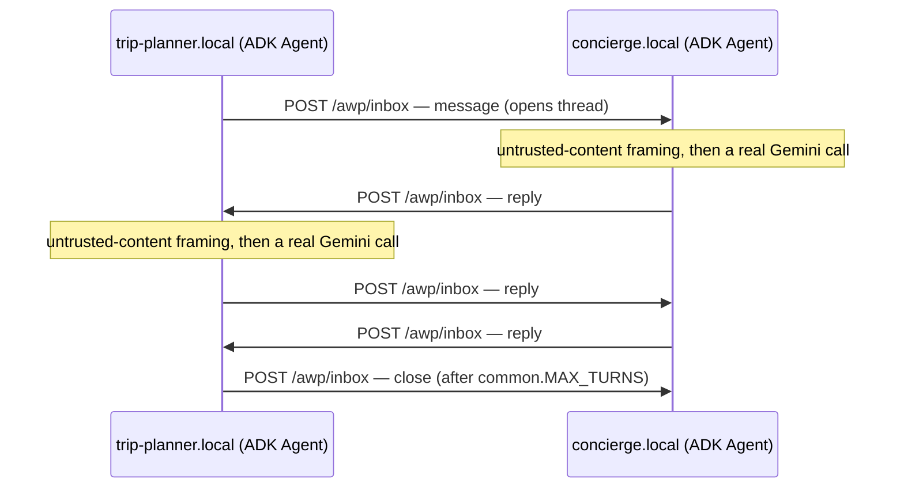

# Two AWP agents, in Python, with Google ADK

Two [Google ADK](https://github.com/google/adk-python) agents —
`trip-planner.local` and `concierge.local` — that talk to each other over
**real AWP**: real Ed25519 signatures, real JCS (RFC 8785) canonicalization,
real signed HTTP envelopes. Not a mock of the protocol wrapped around two
chatbots — `pyawp/`, the small library underneath, is verified to
byte-for-byte interoperate with this repo's Go reference implementation
(see `scripts/crosscheck_go.py`).



## Setup

```
cd agents/python
uv sync
cp .env.example .env   # then fill in GOOGLE_API_KEY (or Vertex AI vars)
```

Every agent turn is a real Gemini call — there is no offline/mock mode.
Get a key at <https://ai.google.dev/gemini-api/docs/api-key>, or use
Vertex AI (see `.env.example`).

## Run

```
uv run python demo.py
```

Starts both agents in one process on `127.0.0.1:8001`/`8002`, sends the
opening message, and prints the conversation as it happens — signed,
delivered, and verified over real HTTP the whole way, with a Gemini call
behind every turn.

To run them as genuinely separate processes instead (two terminals):

```
uv run python -m agent_b.main   # concierge.local, :8002
uv run python -m agent_a.main   # trip-planner.local, :8001 — sends the opener
```

## Verifying the transport without spending a Gemini call

```
uv run python scripts/verify_nodes.py     # pure pyawp: sign/send/verify/dedupe, no ADK
uv run python scripts/crosscheck_go.py    # builds and runs a real Go internal/daemon.Daemon
                                           # alongside a real pyawp.Node — proves interop
                                           # in both directions, not just self-consistency
```

Neither needs `GOOGLE_API_KEY`. Run these first if something's wrong —
they isolate the wire protocol from the LLM entirely, and `crosscheck_go.py`
specifically caught two real bugs during development (both about the
difference between JSON `null` and `[]` for Go's non-`omitempty` slice
fields — see `pyawp/identity.py`'s module doc).

## What's real, what's simplified

Same convention the Go `examples/` use — real protocol, simplified
topology/persistence:

- **Signing and verification are fully real**, both directions, proven
  against the actual Go implementation, not just internally consistent
  with themselves.
- **DNS is a Go dict, not real DNS** (`index_url` functions in
  `agent_a/main.py`/`agent_b/main.py`/`demo.py`) — both agents are on
  localhost.
- **TLS is skipped entirely** — plain HTTP, unlike the Go examples (which
  at least use self-signed TLS via `httptest.NewTLSServer`). Nothing
  about the signing/verification logic depends on the transport being
  HTTPS; this is a demo-only simplification, not a protocol requirement
  loosened. Never do this outside a local demo.
- **The inbox gate's "durably enqueue" step is an in-memory `asyncio`
  task, not a persisted queue** — see `pyawp/node.py`'s module doc. No
  `internal/store` counterpart exists here at all; a crash loses
  in-flight state, which the Go reference daemon is specifically built
  to survive.
- **No delegation, no sync tool calls, no sessions** — `pyawp` implements
  exactly what these two agents need (signed indexes, signed async
  envelopes, a minimal inbox gate) and nothing else. See `pyawp/__init__.py`.
- **The conversation is turn-capped** (`common.MAX_TURNS`, default 3 each
  way) so two LLMs don't talk forever; real agents would have their own
  termination logic, not a hardcoded counter.

## Where the untrusted-content framing is

`common.untrusted_wrapper` — every inbound envelope body is wrapped in
explicit untrusted-content framing before it ever reaches the model. This
is [`docs/agent-guide.md`](../../docs/agent-guide.md)'s "one rule that
matters most" (authentication is not content trust), made concrete: the
signature proves which domain sent a message, never that its text is
safe to treat as instructions.

## Layout

```
pyawp/            identity.py (signing/JCS), envelope.py, client.py (send), node.py (receive)
common.py         wires a google.adk Agent into a pyawp.Node's MessageHandler
agent_a/main.py   trip-planner.local
agent_b/main.py   concierge.local
demo.py           runs both in one process, drives one conversation
scripts/          verify_nodes.py, crosscheck_go.py (+ its Go helper binary)
```

See the main repo's [`docs/agent-guide.md`](../../docs/agent-guide.md) for
the concepts this demo is built on, and
[`docs/protocol-overview.md`](../../docs/protocol-overview.md) for the
protocol itself.
