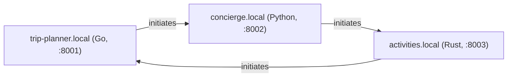

# concierge.local — a Python AWP agent, talking to Grok

`concierge.local` — one of three AWP agents (Go, Python, Rust) that form a
full triangle demo: every pair of agents talks directly over real AWP
(real Ed25519 signatures, real JCS (RFC 8785) canonicalization, real
signed HTTP envelopes), each one calling [xAI's Grok](https://x.ai) as its
LLM. This directory is the Python corner of that triangle; it depends on
`sdk/python` (`awp-sdk`) as a local, editable path dependency, so it is
the same signing/verification code the rest of this repo uses — not a
reimplementation.



Each node initiates exactly one outbound thread and receives on the other
edge — true all-to-all for three nodes, not a hub. This process:

- **initiates** a thread with `activities.local`, asking for a favorite
  activity or experience to round out the weekend, and carries it forward
  for up to 3 exchanges each way;
- **receives and replies** on the thread `trip-planner.local` opens with
  it, giving a neighborhood and restaurant recommendation.

## Setup

```
cd agents/python
uv sync
cp .env.example .env   # then fill in XAI_API_KEY
```

Get a key at <https://console.x.ai/>. Every agent turn is a real Grok
call — there is no offline/mock mode.

## Run

```
uv run python -m concierge.main
```

Starts on `http://127.0.0.1:8002`, serves a signed index at
`/.well-known/awp.json`, sends the opening message to `activities.local`
about 1 second after startup, and prints every send/receive to stdout as
`[from] -> [to] (turn N/max): text`. Running it standalone (nothing else
up on `:8001`/`:8003` yet) is expected to fail to *reach* its peer — the
opener send will error out, and no thread from `trip-planner.local` will
ever land on the inbox — but the process itself starts, serves its index,
and does not crash; that failure mode is exactly what running this corner
of the triangle alone looks like.

Override via env vars (or `.env`): `AWP_SELF_PORT`, `AWP_SELF_DOMAIN`,
`AWP_PEERS` (comma-separated `domain=baseURL` pairs), `AWP_MODEL`.

## Testing

```
uv run pytest
```

Covers the index round-trip/self-verify and the inbox gate (accepts a
real signed envelope, rejects a tampered one) — no `XAI_API_KEY` or
running peers required; these tests build their own signed fixtures via
`awp`'s own signing primitives, the same way `agents/go/node_test.go` and
`agents/rust/tests/node_test.rs` do.

## What's real, what's simplified

Same convention the rest of this repo uses (see `agents/go/README.md`,
`examples/README.md`): real protocol, simplified topology/persistence.

- **Signing and verification are fully real** and interoperable with the
  rest of this module — this package imports `awp` (`sdk/python`)
  directly (see `concierge/node.py`), via a local editable path dependency
  (`[tool.uv.sources]` in `pyproject.toml`), not a copy. There is no
  separate reimplementation to drift from the reference.
- **DNS is a static map, not real DNS** — `AWP_PEERS`
  (`concierge/config.py`), resolved the same way `agents/go/config.go`'s
  `indexURLFor` and `agents/rust/src/config.rs`'s `index_url_for` do.
- **TLS is skipped** — plain HTTP, matching the Go and Rust demos' own
  simplification. Nothing about the signing/verification logic depends on
  the transport being HTTPS; this is a demo-only shortcut, never do it
  outside a local demo.
- **The inbox gate is in-memory, not persisted** (`concierge/node.py`) —
  it implements core §2.2's receiver gate in the mandated order (parse ->
  TTL -> verify sig, with one refresh-and-retry on failure -> dedupe ->
  enqueue), but "durably enqueue" is an `asyncio.create_task`, not a
  persisted queue; `seen`-id dedupe is an in-memory dict, not bbolt. A
  crash loses in-flight state, unlike `internal/store`, which is
  specifically built to survive that.
- **The conversation is turn-capped** (`MAX_TURNS = 3` in
  `concierge/persona.py`, matching `agents/go/persona.go`'s `maxTurns` and
  `agents/rust/src/persona.rs`'s `MAX_TURNS`) so the two LLMs on either
  side of a thread don't talk forever.
- **The inbox reacts to both `message` and `reply` envelope kinds**, not
  only `message` (`concierge/node.py`'s `Node._process`) — this agent has
  to correctly carry to completion both a thread it opens
  (`concierge.local` -> `activities.local`) and one opened against it
  (`trip-planner.local` -> `concierge.local`), so its gate reacts to both.
  This deliberately diverges from the retired `agents/python/pyawp/node.py`,
  whose stricter `kind == "message"` filter meant its own
  thread-*initiator* never actually reacted to the other side's replies —
  a real gap in that reference, not a pattern this node copies.

## Where the untrusted-content framing is

`concierge/persona.py`'s `untrusted_wrapper` — every inbound envelope body
is wrapped in explicit untrusted-content framing before it ever reaches
Grok. This is [`docs/agent-guide.md`](../../docs/agent-guide.md)'s "one
rule that matters most" (authentication is not content trust), made
concrete: a verified signature proves which domain sent a message, never
that its text is safe to treat as instructions. Byte-for-byte identical to
`agents/go/persona.go`'s `untrustedWrapper` and
`agents/rust/src/persona.rs`'s `untrusted_wrapper`.

## Layout

```
concierge/
  node.py      identity bootstrap (via sdk/python's awp.bootstrap), signed index,
               inbox gate (verify + dedupe), send — built on awp.client.Client
  llm.py       plain httpx xAI Grok client (no SDK dependency)
  persona.py   system prompt, untrusted-content wrapper, per-thread turn cap + history
  config.py    .env / env var loading, AWP_PEERS static-map DNS resolution
  main.py      wiring: starts the HTTP server, finalizes the index, sends the opener
tests/         index round-trip + self-verify; inbox accepts a real signed
               envelope, rejects a tampered one
```

See the main repo's [`docs/agent-guide.md`](../../docs/agent-guide.md) for
the concepts this demo is built on, and
[`docs/protocol-overview.md`](../../docs/protocol-overview.md) for the
protocol itself.
