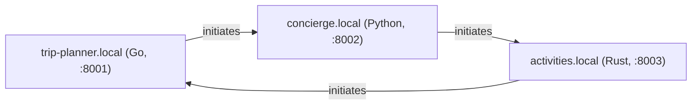

# activities.local — a Rust AWP agent, talking to Grok

`activities.local` — one of three AWP agents (Go, Python, Rust) that form a
full triangle demo: every pair of agents talks directly over real AWP
(real Ed25519 signatures, real JCS (RFC 8785) canonicalization, real
signed HTTP envelopes), each one calling [xAI's Grok](https://x.ai) as its
LLM. This directory is the Rust corner of that triangle; it depends on
`sdk/rust` as a local path dependency, so it is the same signing/verification
code the rest of this repo uses — not a reimplementation.



Each node initiates exactly one outbound thread and receives on the other
edge — true all-to-all for three nodes, not a hub. This binary:

- **initiates** a thread with `trip-planner.local`, offering an activity or
  day-trip recommendation, and carries it forward for up to 3 exchanges
  each way;
- **receives and replies** on the thread `concierge.local` opens with it,
  asking for a favorite activity to round out the weekend.

## Setup

```
cd agents/rust
cp .env.example .env   # then fill in XAI_API_KEY
```

Get a key at <https://console.x.ai/>. Every agent turn is a real Grok
call — there is no offline/mock mode.

## Run

From `agents/rust` (running from here, not the repo root, matters:
`.env` is loaded relative to the working directory):

```
cd agents/rust
cargo run
```

Starts on `http://127.0.0.1:8003`, serves a signed index at
`/.well-known/awp.json`, sends the opening message to `trip-planner.local`
about 1 second after startup, and prints every send/receive to stdout as
`[from] -> [to] (turn N/max): text`. Running it standalone (nothing else
up on `:8001`/`:8002` yet) is expected to fail to *reach* its peer — the
opener send will error out, and no thread from `concierge.local` will ever
land on the inbox — but the process itself starts, serves its index, and
does not crash; that failure mode is exactly what running this corner of
the triangle alone looks like.

Override via env vars (or `.env`): `AWP_SELF_PORT`, `AWP_SELF_DOMAIN`,
`AWP_PEERS` (comma-separated `domain=baseURL` pairs), `AWP_MODEL`.

## Testing

```
cargo test
```

Covers the index round-trip/self-verify and the inbox gate (accepts a real
signed envelope, rejects a tampered one, dedupes a repeated id) — no
`XAI_API_KEY` or running peers required; these tests build their own signed
fixtures via `sdk/rust`'s own signing primitives, the same way
`agents/go/node_test.go` and `agents/python/tests` do.

## What's real, what's simplified

Same convention the rest of this repo uses (see `agents/go/README.md`,
`agents/python/README.md`): real protocol, simplified topology/persistence.

- **Signing and verification are fully real** and interoperable with the
  rest of this module — this package imports `sdk/rust`'s `Client` and
  `identity`/`envelope` types directly (see `src/node.rs`), via a local
  path dependency in `Cargo.toml`, not a copy. There is no separate
  reimplementation to drift from the reference.
- **DNS is a static map, not real DNS** — `AWP_PEERS` (`src/config.rs`),
  resolved the same way `agents/go/config.go`'s `indexURLFor` and
  `agents/python/concierge/config.py`'s equivalent do.
- **TLS is skipped** — plain HTTP, matching the Go and Python demos' own
  simplification. Nothing about the signing/verification logic depends on
  the transport being HTTPS; this is a demo-only shortcut, never do it
  outside a local demo.
- **The inbox gate is in-memory, not persisted** (`src/node.rs`) — it
  implements core §2.2's receiver gate in the mandated order (parse ->
  TTL -> verify sig -> dedupe -> enqueue), but "durably enqueue" is a
  `tokio::spawn`, not a persisted queue; `seen`-id dedupe is an in-memory
  `HashMap`, not bbolt. A crash loses in-flight state, unlike
  `internal/store`, which is specifically built to survive that.
- **The conversation is turn-capped** (`MAX_TURNS = 3` in `src/persona.rs`,
  matching `agents/go/persona.go`'s `maxTurns` and
  `agents/python/concierge/persona.py`'s `MAX_TURNS`) so the two LLMs on
  either side of a thread don't talk forever.
- **The inbox reacts to both `message` and `reply` envelope kinds**, not
  only `message` — this agent has to correctly carry to completion both a
  thread it opens (`activities.local` -> `trip-planner.local`) and one
  opened against it (`concierge.local` -> `activities.local`), so its gate
  reacts to both, matching `agents/go/node.go` and
  `agents/python/concierge/node.py`.

## Where the untrusted-content framing is

`src/persona.rs`'s `untrusted_wrapper` — every inbound envelope body is
wrapped in explicit untrusted-content framing before it ever reaches Grok.
This is [`docs/agent-guide.md`](../../docs/agent-guide.md)'s "one rule that
matters most" (authentication is not content trust), made concrete: a
verified signature proves which domain sent a message, never that its text
is safe to treat as instructions. Byte-for-byte identical to
`agents/go/persona.go`'s `untrustedWrapper` and
`agents/python/concierge/persona.py`'s `untrusted_wrapper`.

## Layout

```
src/
  node.rs      identity bootstrap, signed index, inbox gate (verify + dedupe),
               send — built on sdk/rust's Client and identity/envelope types
  llm.rs       plain reqwest xAI Grok client (no SDK dependency)
  persona.rs   system prompt, untrusted-content wrapper, per-thread turn cap + history
  config.rs    .env / env var loading, AWP_PEERS static-map DNS resolution
  main.rs      wiring: starts the HTTP server, finalizes the index, sends the opener
  lib.rs       module declarations
tests/node_test.rs   index round-trip + self-verify; inbox accepts a real signed
                     envelope, rejects a tampered one, dedupes a repeated id
```

See the main repo's [`docs/agent-guide.md`](../../docs/agent-guide.md) for
the concepts this demo is built on, and
[`docs/protocol-overview.md`](../../docs/protocol-overview.md) for the
protocol itself.
