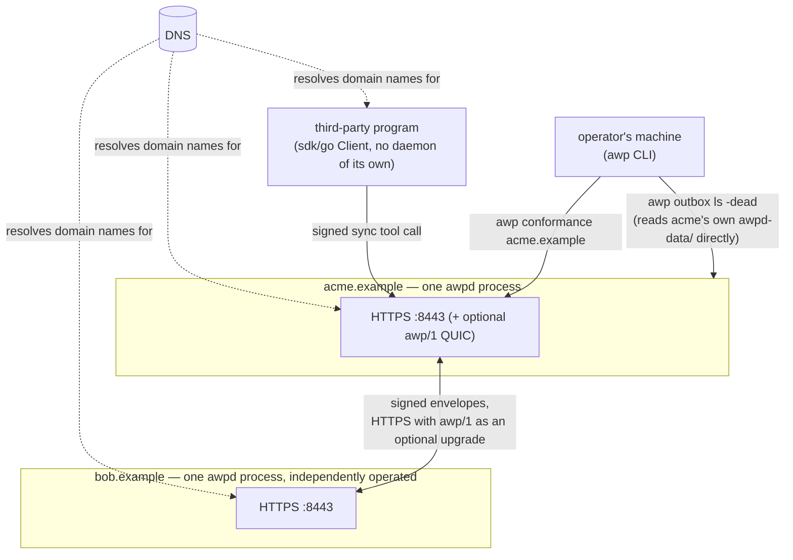
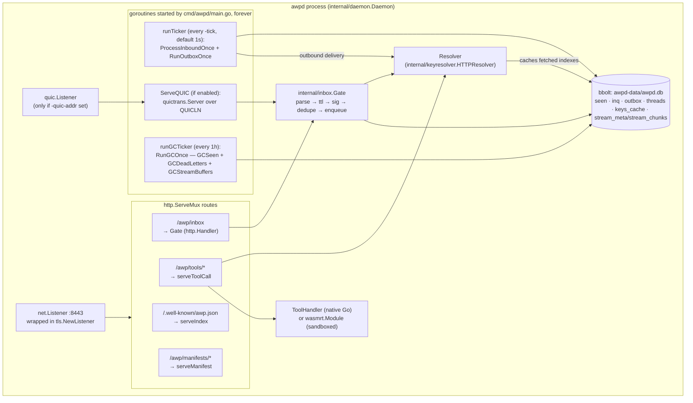
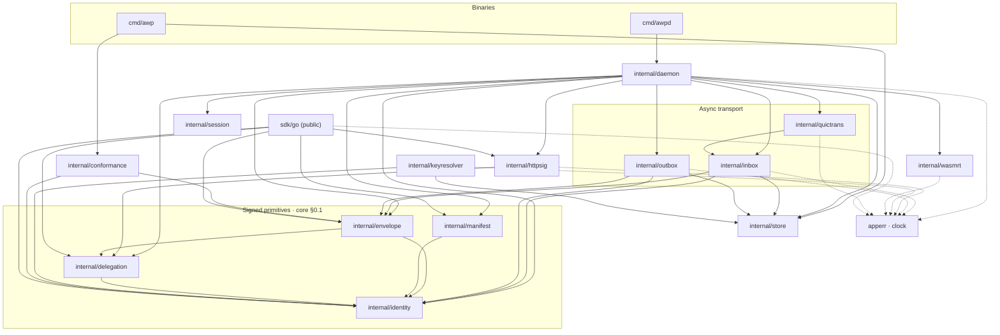
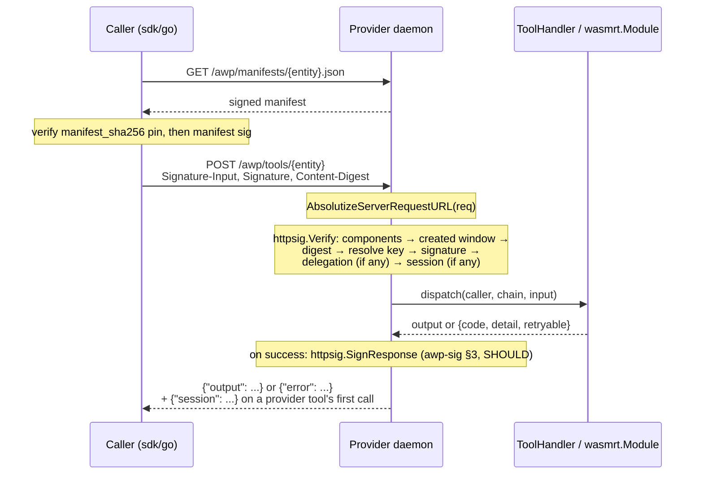

# Architecture

How the `internal/*` packages implement the concepts in
[`docs/protocol-overview.md`](protocol-overview.md), and how a request
actually flows through them. This document describes the *implementation*;
`spec/` remains the normative source (per `CLAUDE.md`: "when code and spec
disagree, the spec wins and the discrepancy gets flagged, not silently
resolved").

This document has three levels, coarsest first: the deployment topology
(what's running, where), one process's internals (what's running inside
`awpd`), and the code-level package dependency graph. Skip to whichever
matches the question you actually have.

## System architecture

### Deployment topology

Nothing coordinates domains from outside — each `awpd` is a fully
independent process that only ever learns about another domain by
resolving its DNS name and fetching its index. There is no broker, no
message bus, no shared infrastructure of any kind between them.



Two independent operators, two independent data stores, two independent
keypairs — the only thing either side trusts is whatever the other's own
signed index says, fetched fresh (or from cache) every time. Nothing
above is specific to two domains; a third, fourth, or thousandth domain
plugs into the same picture with zero coordination.

### Inside one `awpd` process

One binary, one TLS listener, one bbolt file, three background loops —
this is every moving part `cmd/awpd/main.go` actually starts, not a
simplification:



The three loops are the entire runtime beyond serving HTTP requests —
there's no scheduler, no worker pool, no message queue. `RunOutboxOnce`
picking at most one due delivery per destination domain per tick (see
"Why outbox delivery is per-domain-serial" below) is a direct consequence
of there being exactly one loop driving delivery, on a plain
`time.Ticker`.

Notice `EXEC` never touches `STORE`: a sync tool call is entirely
stateless with respect to the bbolt file, on purpose — session tokens
are self-authenticating (core §1.3) precisely so verifying one never
needs a storage read on the hot path. Everything `STORE`-shaped in this
diagram is either async-envelope bookkeeping (`GATE`, `L_TICK`) or the
resolver's own index cache.

## Component map

```
cmd/awpd            single daemon binary — thin CLI/process shell around internal/daemon
cmd/awp              conformance runner + local outbox inspector
sdk/go               public thin client (send/call/delegate, no daemon required)

internal/identity    Ed25519 signing primitive (§0.1), domain index types + rotation/revocation
internal/envelope    envelope type, JCS canon, sign/verify, ULID ids
internal/manifest    manifest type, sign/verify, sha256 pinning
internal/delegation  delegation chain verification (core §2.5)
internal/httpsig     awp-sig-v0.1.md: the RFC 9421 subset for sync calls
internal/session     core §1.3 self-authenticating session tokens
internal/inbox       the core §2.2 receiver gate — transport-blind
internal/outbox      awpd-outbox-v0.1.md delivery retry state machine
internal/store       bbolt persistence (awpd-store-v0.1.md)
internal/keyresolver HTTP index/key resolution with TOFU + rotation continuity, bbolt-cached
internal/quictrans   awp/1 QUIC transport binding (awp-quic-v0.1.md)
internal/wasmrt      wazero sandbox for portable (stdio-json/1) tools
internal/daemon      wires all of the above into what cmd/awpd actually runs
internal/conformance black-box checklist runner (core §5, awp-quic §8) — used by `awp conformance`
internal/apperr      the one {code, detail, retryable} error type, shared everywhere
```

Every package above sits under `github.com/agentask/awp/...`, so `sdk/go`
and `examples/` — also under that path — can legally import any of them,
even though they're `internal/`. Nothing *outside* this repo can. That's
deliberate: `sdk/go` is the one package meant for third parties: it wraps
just enough of `internal/httpsig`, `internal/identity`, `internal/envelope`,
`internal/manifest`, and `internal/delegation` to sign, send, and verify,
without pulling in `internal/store`'s bbolt dependency or
`internal/daemon`'s retry machinery — see
[`docs/sdk-go.md`](sdk-go.md) for exactly where that line is drawn.

The diagram below is the real import graph (`go list -f '{{.Imports}}'`
per package), not an aspirational one — `internal/apperr` and
`internal/clock` are collapsed into one "utility" node since nearly
everything imports at least one and drawing each edge separately would
just be noise. `cmd/awpd` also imports `identity`/`manifest`/
`keyresolver`/`store` directly (for its own key/TLS/demo-tool
bootstrapping in `main.go`), not only transitively through `daemon` —
omitted here for the same reason.



## Flow 1: a sync tool call



```
Caller (sdk/go or any awp-sig-speaking client)
  │  GET  /awp/manifests/{entity}.json  ──────────► internal/daemon.serveManifest
  │  (verify manifest_sha256 pin, then manifest sig)
  │
  │  POST /awp/tools/{entity}, signed per awp-sig
  ▼
internal/daemon.serveToolCall
  │  httpsig.AbsolutizeServerRequestURL(req)   ← see callout below
  │  httpsig.Verify(req, body, now, deps)
  │    ├─ parse Signature-Input, check covered components
  │    ├─ check `created` is within ±300s
  │    ├─ verify Content-Digest (before the signature — never verify a
  │    │  signature over an unchecked digest)
  │    ├─ resolve (domain, kid) → pubkey, one refresh-and-retry on failure
  │    ├─ verify the Ed25519 signature over the reconstructed base
  │    ├─ if AWP-Delegation present: internal/delegation.Verify
  │    └─ if AWP-Session present: internal/session.Verify
  │  dispatch to the registered ToolHandler (native Go) or a wasmrt.Module
  │  if state:provider and no session was presented: session.Issue
  │  on success: httpsig.SignResponse (awp-sig §3, SHOULD) — Caller
  │  verifies this via httpsig.VerifyResponse before trusting the body
  ▼
Response: {"output": ...} or {"error": {code, detail, retryable}}
```

`daemon.RegisterTool` is what publishes the manifest (signing it, pinning
its sha256 into the domain's own index) and registers the executor —
`ToolHandler` for a native Go implementation, or a compiled `wasmrt.Module`
for a portable one. Both paths converge on the exact same
`serveToolCall` — the manifest's `distribution` field is what a caller
uses to decide *how* to reach a tool, not what the daemon uses to decide
how to serve it.

**Why `AbsolutizeServerRequestURL` exists.** `@target-uri` (the covered
component that pins a signature to a specific URL) must be the exact
absolute URI the client signed. A client's `*http.Request` already has
one, because it's built from a full URL string. But Go's `net/http`
*server* strips scheme and host off an incoming request line — `req.URL`
on the server side has only the path; the authority lives separately in
`req.Host`. Calling `httpsig.Verify` on a raw server-received request
without reconstructing `req.URL` first computes a *different*
`@target-uri` than the client actually signed, and every signature fails
— not because anything is cryptographically wrong, but because the
component was never reassembled. This was a real, latent bug caught only
once a test exercised an actual network round trip instead of reusing one
in-memory `*http.Request` for both signing and verifying (see
`internal/httpsig/httpsig_test.go`'s `TestSignVerify_RealHTTPRoundTrip*`).
Every server handler in this repo calls the helper before `Verify`; a
third-party server embedding `internal/httpsig` directly must do the same.

**Why the caller — not the provider — decides a portable tool's
capabilities.** A `distribution.portable` manifest names a URL and a
`sha256`, not an endpoint. The intended flow is: the caller fetches the
manifest and the pinned binary itself, then runs it in its *own*
`wasmrt` sandbox. `wasmrt.Module.Run(ctx, req, wasmrt.Config{Capabilities:
...})` takes the capability grant as a parameter precisely because
whoever is holding the sandbox is who gets to decide what it can touch —
the manifest's declared `capabilities` is a request, not an entitlement.
`wasmrt` grants exactly `"clock"` and `"random"` (via wazero's
`WithSysWalltime`/`WithSysNanotime`/`WithRandSource`); network and
filesystem are not grantable in v0.1 at all. Withholding a capability
doesn't error a call — it makes wazero's WASI clock/RNG a deterministic
fake, which is the correct sandbox behavior for an unauthorized request,
not a missing import. See `examples/portable-wasm-tool` for this running
end to end, calling the same compiled module with and without `"clock"`
granted.

## Flow 2: an async message

```mermaid
sequenceDiagram
    participant S as Sender daemon
    participant G as Receiver's internal/inbox.Gate
    participant R as Receiver daemon

    S->>S: Send(kind, to, thread, ...) — sign, EnqueueOutbound
    S->>G: POST {inbox} — signed envelope
    Note over G: 1 parse ≤256KiB → 2 ts+ttl → 3 verify sig<br/>(1 refresh retry) → 4 dedupe id → 5 enqueue
    G-->>S: 202 Accepted (transport ack only)

    R->>R: ProcessInboundOnce (own schedule)
    Note over R: RecordThreadEnvelope; if kind==message,<br/>reference handler sends ack, then reply
    R->>S: POST sender's inbox — kind=ack
    R->>S: POST sender's inbox — kind=reply
    Note over S,R: each delivery re-enters this same diagram<br/>from the other side — ack/reply are just envelopes too
```

```
Sender                                          Receiver
  │ daemon.Send(kind, to, thread, ...)
  │   sign envelope (internal/envelope)
  │   EnqueueOutbound (internal/store)
  │
  │ RunOutboxOnce → outbox.ProcessDue
  │   picks ≤1 due record per destination domain per call
  │   POST {inbox}, byte-identical envelope on every retry
  ▼
                                          internal/inbox.Gate (transport-blind)
                                            1. parse (≤256 KiB)              → 400
                                            2. now ≤ ts + ttl                → 410
                                            3. verify sig (1 refresh retry)  → 401
                                            4. dedupe on id                  → 200 (already accepted)
                                            5. durably enqueue               → 202 / 503
                                          ProcessInboundOnce (own schedule)
                                            record thread state (store.RecordThreadEnvelope)
                                            if body.type == "stream_chunk": reassemble (any kind) —
                                              see the streaming callout below; short-circuits the rest
                                            else if kind == "message": run Config.MessageHandler
                                              (default: send ack, then reply — see callout below)
                                            send(...) for any response → back through the sender's own outbox
```

**Why the gate's order is part of the contract, not an implementation
detail.** `internal/inbox.Gate` is deliberately transport-blind — HTTP
and QUIC (`internal/quictrans`) are both thin adapters over the exact
same `Gate.Process`, which is what `awp-quic-v0.1.md`'s "gate
equivalence" requirement actually means in code: the same envelope hits
the same five checks in the same order regardless of which transport
carried it. The order itself is normative (core §2.2): TTL is checked
*before* the signature, so an expired envelope never pays for a
signature verification; the signature is checked *before* the dedupe
lookup, so a forged `id` can't be used to probe whether a real one was
already seen; delegation verification happens at *processing* time, not
in the gate, so the gate stays O(1) crypto per request regardless of
delegation chain length. `internal/inbox`'s own tests assert the order
directly (a gate-order matrix), not just the individual status codes —
getting the right code for the wrong reason is exactly the kind of bug
that order-blind testing would miss.

**Why `MessageHandler` gets a `send` closure instead of raw access to
`Send`.** `Config.MessageHandler`'s third parameter is pre-bound to the
inbound message's `to`/`thread`/`in_reply_to` — a handler only ever
chooses `kind` and `body`. This isn't hiding capability for its own sake:
every response to a `message` genuinely does belong to that message's
thread, addressed back to its sender, so making that the only path
available removes an entire class of bug (a handler that means to reply
but fingers the wrong thread or the wrong recipient) rather than
documenting "don't do that." The reference default
(`defaultMessageHandler`, used when `Config.MessageHandler` is nil) is
just this same closure called twice — see `examples/custom-message-handler`
for a real handler and `examples/agent-messaging` for the default,
side by side.

**Why stream_chunk detection happens before the kind check, not inside
`MessageHandler`.** `awp-streaming-v0.1.md` chunks typically carry
`kind: reply` (answering a request, not making one), and
`ProcessInboundOnce` never invoked any handler at all for non-`message`
kinds before this existed — so reassembly couldn't live inside
`MessageHandler` without also making every reply-kind envelope
newly dispatch through it, a much bigger behavior change than adding
one feature warrants. `tryProcessStreamChunk` runs first, regardless of
`kind`, and buffers/reassembles through `internal/store`'s bounded
(65536 chunks/stream_id) reassembly bucket; each chunk that becomes
deliverable (in order, gap-free) is pushed to `Config.StreamChunkHandler`
if set. A malformed body or a bound violation gets an `error` envelope
back to the sender instead — the same `send`-style mechanism
`MessageHandler` uses, just internal to `tryProcessStreamChunk` rather
than caller-supplied.

**Why outbox delivery is per-domain-serial, not per-envelope-parallel.**
`outbox.ProcessDue` starts at most one in-flight delivery per destination
domain per call — visible in `examples/agent-messaging`, where two
envelopes queued to the same domain in the same tick land one tick
apart. This isn't a missing optimization; it bounds how hard one daemon
can hammer one peer regardless of how much it has queued for them, and
it's why `cmd/awpd` runs `RunOutboxOnce` on a plain timer forever rather
than trying to drain a queue in one pass.

## Persistence and crash recovery

`internal/store` is the only stateful package; everything else is either
pure functions or holds state only in memory (`wasmrt.Module`,
`quictrans.Sender`'s connection pool). Every store method that spans more
than one bucket write does so inside a single bbolt transaction — e.g.
`RecordThreadEnvelope` opens/continues a thread and archives the envelope
atomically; `AcceptInbound` marks an id `seen` and enqueues it in the same
transaction, so a kill-9 between "recorded as seen" and "queued for
processing" is impossible by construction, not by luck. `BootRecovery`
and `InboundBootRecovery` run once at daemon startup and move anything
left `in-flight` (a delivery attempt or an inbound claim that never
completed) back to a clean queued state — see `internal/daemon.New`'s
call sites in `cmd/awpd/main.go` for where this runs relative to opening
the store.

`RunGCOnce` (called hourly by `cmd/awpd`, per `awpd-store-v0.1.md` §2)
deletes expired `seen` entries, dead-lettered outbound records past
their retention window, and incomplete stream reassembly buffers that
haven't seen a new chunk in `Config.StreamBufferMaxAge`
(`awp-streaming-v0.1.md` §5's "detecting an incomplete stream is a
receiver-local concern") — see [`docs/deployment.md`](deployment.md)
for tuning this.

## Identity resolution

`internal/keyresolver.HTTPResolver` is the production `Resolver`
`cmd/awpd` wires into `internal/daemon`: it fetches
`/.well-known/awp.json` over HTTPS, caches the result in `store`'s
`keys_cache` bucket, and re-fetches on the core §0.1 "one refresh before
hard-failing" rotation race. Its `Refresh` also enforces rotation
continuity against whatever was previously cached (see the package's own
doc comment for the exact reasoning) — a re-fetched index can only
replace the trusted key with one that has a valid `prev_sig` chain back
to it, or an identical key; anything else is rejected and the *old*
cache entry is kept. Deliberately re-trusting a domain after a real,
out-of-band identity change is a separate, explicit `Reset` call, never
an implicit side effect of a normal refresh.

`sdk/go`'s `awp.Client` implements the same TOFU trust model with its own
much simpler in-memory-only cache (no bbolt, no continuity enforcement
across restarts) — appropriate for a short-lived client process, not for
a long-running daemon. `examples/agent-messaging`'s `httpResolver` is a
third, even smaller variant, written inline in the example to make the
resolution step itself legible without any caching at all.

## Where to go next

- [`docs/sdk-go.md`](sdk-go.md) — the client-facing API surface.
- [`docs/cli-reference.md`](cli-reference.md) — `awpd`'s and `awp`'s
  actual flags.
- [`docs/deployment.md`](deployment.md) — running this for real: TLS,
  QUIC, retention.
