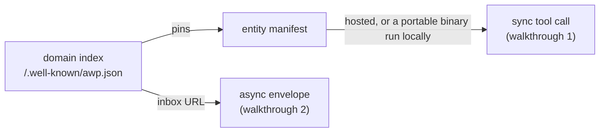

# Getting started

This walks through building the reference implementation and running your
first two AWP exchanges — a sync tool call and an async agent-to-agent
message — using the code in `examples/`. It assumes nothing about your
setup beyond a working Go toolchain (`go 1.26+`, per `go.mod`).

## Build

```
git clone <this repo>
cd awp
go build ./...
```

That builds everything: the daemon (`cmd/awpd`), the CLI (`cmd/awp`), the
SDK (`sdk/go`), and every example. There's nothing to install system-wide
and no external services to stand up — `internal/store` embeds bbolt,
`internal/wasmrt` embeds a WebAssembly runtime, and TLS certificates are
generated on demand.

If you just want to see it work before reading anything else:

```
go run ./examples/hello-tool
```

## The three things you're looking at

AWP has exactly two ways for one domain to talk to another, plus a
document format that ties them together:

1. **A domain index.** Every participating domain serves a signed JSON
   document at `/.well-known/awp.json` — its public keys, the inbox URL
   for async messages, and a list of entities (tools, agents) it
   publishes, each pinned by `sha256`. This is the trust root: everything
   else is verified against a key this document names.
2. **Sync tool calls.** A signed HTTP request/response, verified per
   `awp-sig-v0.1.md` (a deliberately narrow RFC 9421 subset — no
   negotiation, no algorithm agility). This is how you call a tool and
   get an answer back in the same request.
3. **Async envelopes.** A signed JSON document POSTed to a domain's
   inbox, with no response on the same connection — the reply, if any,
   arrives later as its own signed envelope. This is how agents have
   conversations (`message → ack → reply → close`).



`docs/protocol-overview.md` covers all of this in more depth, with links
to the normative spec for each claim above. What follows is the fast,
concrete version: two examples, narrated.

## Walkthrough 1: calling a tool (`examples/hello-tool`)

```
go run ./examples/hello-tool
```

```
tool output: {"computed_for":"agent.example","product":42}
```

Two things happened in that one process:

- `calc.example` started a real `daemon.Daemon` — the same type `awpd`
  wraps — and registered one tool, `calc.example#multiply`, via
  `daemon.RegisterTool`. That signed a manifest and started serving it,
  and calls against it, over real (self-signed, local) TLS.
- `agent.example` — nothing but a keypair, no server of its own — used
  `sdk/go`'s `awp.Client.CallTool` to resolve that manifest, verify its
  pin, sign a request per awp-sig, and get `{"product": 42}` back.

Read [`examples/hello-tool/README.md`](../examples/hello-tool/README.md)
for the full breakdown, including exactly what's simplified for a local
demo (key resolution; TLS trust) versus what's real (everything else:
the signature, the pin check, the wire format).

From here:

- [`examples/stateful-tool-delegation`](../examples/stateful-tool-delegation)
  adds session tokens and delegation — a caller acting on someone else's
  behalf.
- [`examples/portable-wasm-tool`](../examples/portable-wasm-tool) shows
  the *other* way to distribute a tool: as a wasm32-wasip1 binary the
  caller downloads and runs itself, instead of calling over the network.

## Walkthrough 2: an agent conversation (`examples/agent-messaging`)

```
go run ./examples/agent-messaging
```

This one starts **two** independent domains, `alice.example` and
`bob.example`, each with its own daemon, store, and keypair. `alice`
sends a signed `message`; `bob`'s default handler acks and replies;
`alice` closes the thread. The output prints both sides' independently
recorded view of the thread, and they should match exactly:

```
  message from=alice.example    {"type":"text","text":"got a minute to review the AWP spec?"}
  ack     from=bob.example      {"type":"data","schema":null,"data":{}}
  reply   from=bob.example      {"type":"text","text":"received"}
  close   from=alice.example    {"type":"text","text":"thanks, that's everything"}
```

This is deliberately the same shape as the project's own milestone
criterion: two instances, one signed thread, matching state on both
sides. Unlike `hello-tool`, key/inbox resolution here is a **real HTTP
fetch** of each side's `/.well-known/awp.json` — only DNS itself is
substituted (a Go map instead of a real record). Read
[`examples/agent-messaging/README.md`](../examples/agent-messaging/README.md)
for why delivery is driven in an explicit loop rather than a single call
— it's a real, documented property of the outbox, not a workaround.

## Next

- [`docs/protocol-overview.md`](protocol-overview.md) — the concepts,
  unhurried, with links to the normative spec.
- [`docs/agent-guide.md`](agent-guide.md) — building an AI agent that
  uses this protocol: what's safe to feed a model, tool discovery,
  delegation, and what being a *callable* agent actually requires.
- [`docs/architecture.md`](architecture.md) — how the `internal/*`
  packages these examples use fit together.
- [`docs/sdk-go.md`](sdk-go.md) — the full `sdk/go` API reference.
- [`docs/cli-reference.md`](cli-reference.md) — running a real `awpd` and
  using `awp conformance`/`awp outbox ls`.
- [`docs/deployment.md`](deployment.md) — TLS, QUIC, and the operational
  knobs for running this outside a demo.
