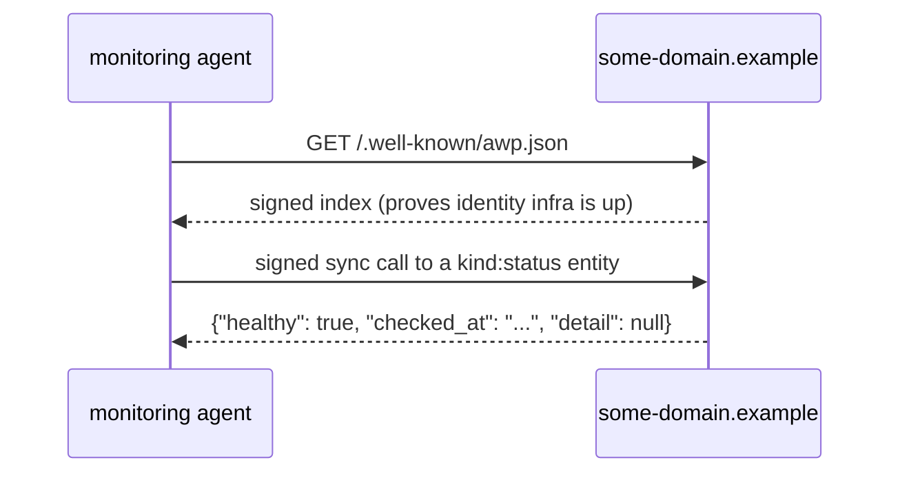

# Recommended patterns

Non-normative. Everything here is a convention — a suggested way to use
primitives that already exist (or, for `status`/`received`, primitives
registered in `spec/awp-kinds-v0.1.md`) — not a wire-format rule.
Nothing in this document can make an implementation non-conforming;
`spec/*.md` is where those rules live. If something here turns out to
need real protocol support (a new field, a new required behavior), it
belongs in `ideas/` first, the way `spec/awp-streaming-v0.1.md` and
`spec/awp-kinds-v0.1.md` both started there.

## Self-service usage/quota reporting

A provider that wants callers to be able to check their own usage
against a quota doesn't need any new protocol mechanism — this is fully
expressible today as an ordinary `kind: tool` entity, using the session
machinery that already exists (core §1.3).

```json
{
  "name": "provider.example#usage",
  "kind": "tool",
  "state": "provider",
  "io": {
    "output": {
      "type": "object",
      "properties": {
        "used": { "type": "integer" },
        "limit": { "type": "integer" },
        "resets_at": { "type": "string", "format": "date-time" }
      }
    }
  }
}
```

A caller's first call establishes a session (core §1.3's normal
lifecycle — the session scope is *(caller principal, entity)*, so this
naturally reports each caller's own usage, not anyone else's); every
subsequent call is just "what's my usage right now."

**Why this isn't a spec addition.** A protocol-level "quota" concept
would need to define what's being metered (calls? bytes? cost, once
pricing exists?), which is exactly the kind of thing that varies per
provider and shouldn't be standardized prematurely. A `usage` tool with
a provider-defined output shape is the right amount of structure for
v0.1: consistent enough to be discoverable (any caller can look for a
`kind: tool` entity with a name ending in a self-service pattern like
this), flexible enough not to force every provider's metering model into
one schema.

## Using `status` entities (`spec/awp-kinds-v0.1.md` §2)

A `status` entity answers "is this specific thing healthy," not "is the
domain's identity infrastructure up." Fetching `/.well-known/awp.json`
and getting back a validly-signed index already proves the latter — a
`status` entity exists for callers who need the former.



Good candidates for a domain to expose as `kind: status`: a specific
downstream dependency your tools rely on, a queue-depth or
request-latency threshold, anything where "the index responds" would
give a caller false confidence. A domain with nothing more specific to
report than "the daemon is running" doesn't need a `status` entity at
all — that's what the index fetch above already demonstrates.

Conformance/monitoring tooling (a `docs/deployment.md`-style operational
concern) is the most natural consumer: `awp conformance <domain>`
already includes `awp-kinds-2-status-entity`, which looks for a
`kind: status` entity and reports what it finds, the same way it
already reports on the domain index itself.

## Using `received` vs `ack` (`spec/awp-kinds-v0.1.md` §1)

Send `received` when your system has taken custody of an envelope but
hasn't yet decided anything about it — a queue accepted it, nothing more.
Send `ack` (core §2.4) only once something has actually decided to
engage with the message. The distinction matters most for senders
tracking a thread's progress: a `received` with no `ack`/`reply`/`error`
following it within a reasonable window is a legitimate signal that
something is stuck, in a way that's indistinguishable from a healthy
"still working" state if the receiver only ever sends `ack`.

Most receivers don't need this distinction — the reference daemon's
default message handler (`internal/daemon`'s `defaultMessageHandler`,
`docs/agent-guide.md`'s "being called" section) sends `ack` immediately
because it always intends to act. Reach for `received` specifically when
your architecture has a real gap between "accepted" and "a decision was
made" — e.g. a queue-backed system where those two things can be minutes
apart.

## Streaming responses (`spec/awp-streaming-v0.1.md`)

Unlike `status`/`received`/quota-reporting above, streaming has real
normative substance (a new `body.type`, reassembly rules, a fixed
buffer bound) — it's not purely a convention. This section is about
*when* to reach for it, which is a judgment call this repo's spec
deliberately leaves to the caller.

Use streaming (a `task` sent to a `kind: agent` entity, answered as a
`stream_chunk` sequence) when a response is produced incrementally and
a caller benefits from seeing it as it arrives — token-by-token model
output, a long-running computation reporting progress. Don't reach for
it just because a response is *large*: a single `reply` envelope is
simpler, and the core §2.1 256 KiB cap is generous for most non-model
content; `resource` (core §2.3, a `sha256`-pinned URL reference) is the
right tool for large opaque payloads, not chunking.

**Chunking granularity matters more than it looks.** Every chunk is a
fully independent, fully signed envelope — one Ed25519 signature, one
delivery attempt, the full fixed per-envelope overhead core already
has. `awp-streaming-v0.1.md` §7 is explicit: coalesce to sentences,
paragraphs, or a bounded time window, not one chunk per model token.
The cryptographic cost itself is negligible (sub-millisecond Ed25519
verification); the overhead that actually adds up is everything else
an envelope carries regardless of how little `data` it holds.

**Consuming a stream on the receiving side:** set
`daemon.Config.StreamChunkHandler` — it's invoked once per chunk, in
order, with no gaps, after `internal/daemon`'s own reassembly buffering
already resolved any out-of-order arrival. Leaving it unset doesn't
lose anything; chunks are still correctly reassembled and permanently
archived (`Store.ThreadMessages`, like any other envelope), just not
pushed anywhere — reach for the handler when you want incremental
delivery (e.g. streaming partial content into a UI) rather than reading
the whole thing back after the fact. `sdk/python`'s `Client` has no
handler equivalent by design (it's a stateless, no-store SDK for
third-party programs) — `Client.send_stream_chunk` is producer-side
only; consuming a stream from Python means either running a real
daemon or reassembling from repeated `send_envelope`-style polling
against your own storage, which this SDK deliberately doesn't
prescribe.

## Where to go next

- [`docs/agent-guide.md`](agent-guide.md) — the broader question of what
  an agent's own reasoning loop should do with any of this.
- [`docs/architecture.md`](architecture.md) — how the existing session
  and gate machinery this document leans on actually works.
- `spec/awp-kinds-v0.1.md`, `spec/awp-streaming-v0.1.md` — the two
  normative additions this document assumes.
- [`docs/protocol-overview.md`](protocol-overview.md#extensions-beyond-core-v01)
  — every other registered extension (capabilities, versioning, push,
  transactions, the `awp-ws/1` transport) this document doesn't cover.
