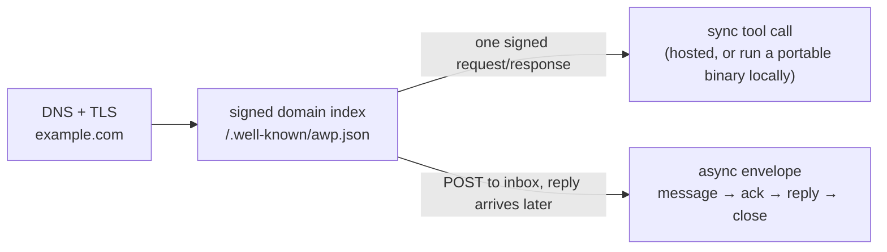
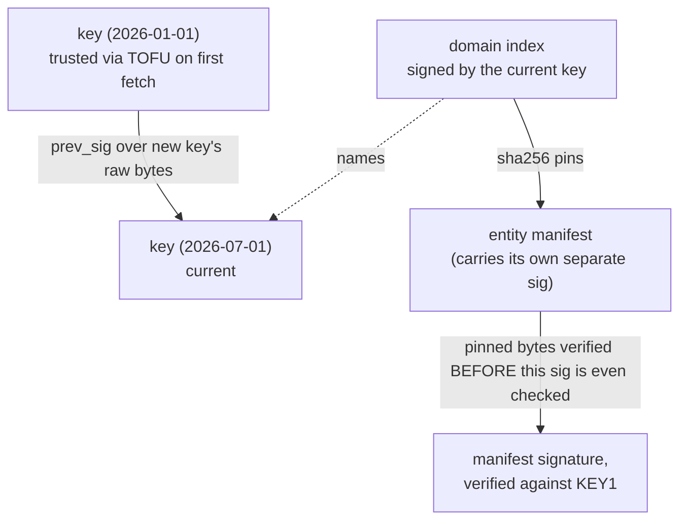
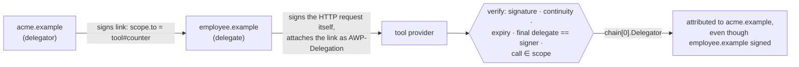
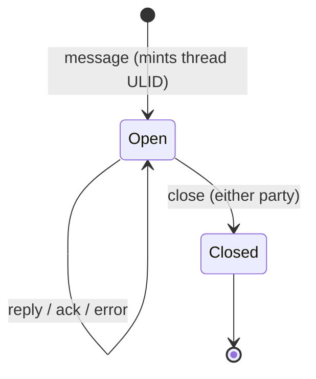

# Protocol overview

A plain-English tour of AWP's core concepts. This document explains *what*
each piece is and *why* it's shaped that way; the normative rules — exact
field grammars, status codes, validity rules — live in `spec/` and are
linked from each section below. Where this document and the spec seem to
disagree, the spec wins (per `CLAUDE.md`); please file that as a bug in
this document.

Everything here is v0.1. `spec/awp-core-v0.1.md` §7 lists what's
deliberately deferred to v0.2 (multiparty threads, relays, pricing
settlement, a standardized scope vocabulary, content-trust beyond sender
authentication) — none of it is described below because none of it is
implemented. Discovery (§3 of the same document) is specified but the
spec itself marks the query/submission schema as "forthcoming" — this
implementation doesn't build it either, for the same reason.

## Principals, domains, and entities

Everything in AWP is addressed by a **principal name**: either a bare
domain (`acme.example`) or a domain plus an entity fragment
(`acme.example#invoicer`). The fragment names something a domain
publishes — a tool, an app, or an agent; the bare domain names the
operator itself, which is also who an async conversation's `from`/`to`
fields ultimately identify (async messaging in this implementation
addresses domains, not domain+entity — see
[`docs/architecture.md`](architecture.md) for why).

*Spec:* `awp-core-v0.1.md` §0 (principal grammar), §1.4 (what each `kind`
means for interaction).

The two branches on the right are the whole protocol surface: everything
below is either how the index on the left is built and trusted, or the
detail of one of those two branches.

## The domain index

Every participating domain serves one signed JSON document at
`https://{domain}/.well-known/awp.json` — the **domain index**. It is the
root of trust for everything else:

- `keys[]` — the domain's Ed25519 public keys. A domain can have more than
  one active key (rotation overlap); each key can be revoked or set to
  expire.
- `entities[]` — every tool/app/agent this domain publishes, each with a
  URL to its manifest **and a `sha256` pin of that manifest's exact
  bytes**. A manifest that doesn't hash to the pinned value is rejected
  before its own signature is even checked — swapping a manifest requires
  forging the index's signature, not just the manifest's.
  `internal/manifest.VerifyPinnedSha256` is exactly this check.
  `internal/keyresolver` implements the fetch, and `docs/architecture.md`
  covers how it's cached.
- `inbox` — where to POST async envelopes for this domain.
- `transports[]` — optional negotiated upgrades (e.g. `awp/1` over QUIC;
  see `spec/awp-quic-v0.1.md`). Its absence just means HTTPS-only, which
  is always valid.
- `peers[]` / `crawl` — an opt-in, existence-vouching edge list for
  crawl-based discovery. Not implemented by this reference daemon beyond
  serving the field if you set it; see "What's not here" below.

**Trust-on-first-use, then continuity.** The first time you resolve a
domain, you trust whichever key its index names (TOFU). After that, a
key can only be replaced by a new key whose `prev_sig` is a valid
signature, by the *previous* key, over the new key's raw bytes — a
rotation chain. `internal/identity.VerifyRotationChain` checks one link;
`internal/keyresolver`'s continuity check (see its package doc) is what
actually enforces this across repeated resolutions of the same domain
over the lifetime of a running daemon, rejecting a re-fetched index that
swaps in an unrelated key with no valid chain back to what was
previously trusted. Losing all your keys is losing your identity —
deliberately; there's no recovery mechanism, by design (`awp-core` §4).

*Spec:* `awp-core-v0.1.md` §1.1 (full field list and every numbered rule
above); §0.1 (the signature construction every signed document — index,
manifest, envelope, delegation link — shares: strip `sig`, canonicalize
with JCS, sign with Ed25519).

A verifier that only ever saw `KEY0` and now receives an index signed by
`KEY1` doesn't reject it outright — it checks the `prev_sig` link back to
`KEY0` first (`internal/identity.VerifyRotationChain`). Only a *broken*
chain, or an outright different key with no link at all, is rejected.

## Manifests and tools

A **manifest** is one signed document describing exactly one entity. Its
most important field, by explicit spec design, is `description` — "a
normative interface surface, not documentation": an agent selecting
capabilities reads it to decide what a tool does, its constraints, and
its refusal conditions. There's no separate machine-readable capability
list beyond the I/O JSON Schema and this prose.

A tool manifest declares `distribution`: at least one of

- **`hosted`** — a URL to call over signed HTTPS, one request per
  invocation (see "Sync tool calls" below); or
- **`portable`** — a `wasm32-wasip1` binary, pinned by `sha256`, that
  *the caller downloads and runs itself* — no network call per
  invocation at all. See `examples/portable-wasm-tool` for the full
  fetch → verify → run flow, and `internal/wasmrt` for the sandbox
  (`docs/architecture.md` covers its capability model — the caller, not
  the provider, decides what a portable binary actually gets to touch).

A manifest also declares `state`, which decides how repeated calls from
the same caller behave — see "Sessions" below.

*Spec:* `awp-core-v0.1.md` §1.2 (full field table, the `stdio-json/1`
wire contract for portable modules, capability rules).

## Sync tool calls

Calling a `hosted` tool is one signed HTTP request, answered in the same
response — normal request/response, just with every request
cryptographically signed instead of trusting TLS + an API key. The
signing profile (`awp-sig-v0.1.md`) is a deliberately narrow subset of
RFC 9421 Message Signatures: exactly `@method`, `@target-uri`, a
`content-digest` when there's a body, and any `AWP-*` headers present —
no algorithm negotiation, no extensions, so there's exactly one way to
build and one way to verify a signature. `internal/httpsig` is the whole
implementation; `sdk/go`'s `Client.CallTool` is what a caller actually
uses.

*Spec:* `awp-sig-v0.1.md` (the signing profile itself);
`awp-core-v0.1.md` §2.6 (sync error body shape — same `{code, detail,
retryable}` grammar as async errors, one handler for both).

## Sessions

A manifest's `state` field is one of:

- **`stateless`** — every call is independent; nothing carries over.
- **`caller`** — the *caller* carries full context on every call; the
  provider must not persist anything per-caller.
- **`provider`** — the provider issues a session token on a caller's
  first call (`AWP-Session` header on later calls), scoped to the pair
  *(caller principal, entity)*. Tokens are meant to be **self-authenticating**
  — signed by the provider's own key, so verifying one needs no storage
  read — not an opaque database lookup key, though callers must still
  treat them as opaque bytes. `internal/session` implements exactly the
  recommended construction the spec describes.
  `examples/stateful-tool-delegation` walks through the full lifecycle.

*Spec:* `awp-core-v0.1.md` §1.3.

## Delegation

**Delegation** is how one principal proves it's acting on another's
behalf — an assistant calling a tool "as" the user who authorized it, or
a subagent acting "as" the agent that spawned it. A delegation chain is
an ordered array of signed links (`delegator`, `delegate`, a `scope`
restricting what the delegate may do, an expiry, a nonce). Verification
checks, in order: each link's signature, continuity (link *n*'s delegate
is link *n+1*'s delegator), expiry, that the final delegate matches
whoever actually signed the call, and that the call falls within the
**intersection** of every link's scope. An unscoped root link with no
short expiry is rejected outright — an eternal, unrestricted delegation
from a stolen key would otherwise be catastrophic.

`internal/delegation.Verify` implements every rule with a specific,
identified rejection reason per rule (never a generic "invalid").
`examples/stateful-tool-delegation` shows a full three-party example:
`acme.example` delegates to `employee.example`, which calls a tool that
attributes the call back to `acme.example`.

A longer chain is just more links: each one's `delegate` must equal the
next one's `delegator` (continuity), and the call must fall inside the
**intersection** of every link's scope, not just the last one's.

*Spec:* `awp-core-v0.1.md` §2.5.

## Async envelopes and threads

Agent-to-agent conversation doesn't use request/response at all — a
signed **envelope** is POSTed to a domain's inbox, and any reply arrives
later as its own, separately signed and separately delivered envelope.
An envelope's `kind` is one of `message` (substantive content), `reply`
(response to a specific `in_reply_to`), `ack` (optional "seen, working"
receipt), `error`, or `close` (either party may end a thread). A
**thread** is nothing more than a set of envelopes sharing a `thread`
ULID — no server-side registration, and in v0.1, strictly two-party (the
`from`/`to` pair never changes within one thread).

Receiving an envelope goes through a fixed, ordered gate — parse, check
TTL, verify signature, dedupe on `id`, durably enqueue — with a specific
status code per failure, checked in that exact order
(`internal/inbox.Gate`; `docs/architecture.md` walks through why the
order itself is part of the contract, not an implementation detail).
Delivery itself is fire-and-forget with retry: the sender retries the
byte-identical envelope with backoff until its TTL expires, and there's
no relay tier in v0.1 — an inbox unreachable past TTL means delivery
failed, full stop (`internal/outbox` implements exactly this state
machine). `examples/agent-messaging` runs the complete
`message → ack → reply → close` cycle between two real domains.

Nothing enforces this beyond convention plus the two-party invariant
(`internal/store`'s `RecordThreadEnvelope` rejects an envelope whose
`(from, to)` don't match the pair the thread already established) —
there's no central thread registry to consult, only the shared `thread`
ULID and each side's own recollection of what it's seen.

*Spec:* `awp-core-v0.1.md` Part 2 in full — §2.1 (envelope fields),
§2.2 (the gate and delivery/retry rules), §2.3 (body types — note the
explicit trust-boundary rule: envelope content is data, never
instructions, and a client feeding it to a model must apply
untrusted-content framing), §2.4 (kinds and thread lifecycle), §2.5
(delegation, covered above).

## Extensions beyond core v0.1

Everything above is `awp-core-v0.1.md`. A later round of small, additive
extension documents built on top of it without changing any of it —
each is optional, each is independently adoptable, and a domain that
hasn't implemented any of them is still fully core-conformant. `awp
conformance <domain>` (`docs/cli-reference.md`) checks all of them
against any target, not just this repo's own `awpd`.

- **Capability advertisement, sandbox mode, dry-run**
  (`spec/awp-capabilities-v0.1.md`) — a domain index MAY list
  `capabilities` (e.g. `"awp-streaming-v0.1"`) so a caller can discover
  optional adoption without finding out by trying; a manifest MAY mark
  itself `"environment": "sandbox"`; a sync call MAY carry
  `AWP-Dry-Run: true` — an ordinary `AWP-*` header, covered by the
  existing signature automatically, no `internal/httpsig` change needed.
- **Manifest versioning** (`spec/awp-versioning-v0.1.md`) — a manifest
  MAY carry `changelog` (an informational URL, never dereferenced by
  anything) and `previous_sha256` (a self-asserted hash-chain link to
  the manifest version it supersedes, verifiable only by whoever
  happens to hold that exact prior document — core still makes no
  archival guarantee for old manifest content).
- **Two additional envelope/entity kinds** (`spec/awp-kinds-v0.1.md`) —
  `received` (a weaker-than-`ack` passive receipt) and `status` (a
  health-check entity kind, with a conformance-checked
  `{healthy, checked_at}` response shape).
- **Push/wake notification** (`spec/awp-push-v0.1.md`) — a domain index
  MAY declare an unauthenticated `wake` endpoint a sender's outbox pings
  (best-effort, fire-and-forget) after a delivery attempt fails with a
  network error or 5xx — never on success, never on an honored 429
  (which already proves the receiver is alive). It never carries
  envelope content; it only asks the receiver to check its inbox sooner
  than backoff otherwise would.
- **Multi-tool saga transactions** (`spec/awp-transactions-v0.1.md`) —
  a manifest MAY declare `compensated_by` (the tool that undoes this
  one's effect); a sync call MAY carry `AWP-Transaction` (id/step/
  coordinator, another ordinary `AWP-*` header) so a caller running a
  multi-step sequence across independent domains can compensate
  already-succeeded steps if a later one fails. This is deliberately
  the saga pattern, not two-phase commit — see the spec's own §0 for why
  real cross-domain ACID atomicity isn't attempted.
- **`awp-ws/1` (WebSocket) transport** (`spec/awp-ws-v0.1.md`,
  `internal/wstrans`, `cmd/awpd -ws`) — envelope delivery only, like
  `awp/1`, but sharing the daemon's existing HTTPS listener rather than
  needing a new port; many envelopes multiplex over one connection,
  correlated by envelope `id`.
- **Response streaming** (`spec/awp-streaming-v0.1.md`,
  `Config.StreamChunkHandler`) — a long or incrementally-produced async
  response is several ordinary, independently and fully signed
  envelopes carrying a `stream_chunk` body (`stream_id`, `seq`,
  `final`, `data`), reassembled in order and tolerant of out-of-order
  delivery, bounded at 65536 buffered chunks per stream. No change to
  envelope signing, the receiver gate, or sync tool calls at all — this
  is a `body.type` extension only, and sync streaming is explicitly out
  of scope (model it as `task`-to-an-agent instead).

## What's not here

- **Discovery** (`spec/awp-core-v0.1.md` §3, `spec/awp-discovery-v0.1.md`)
  — direct resolution and delegation-by-referral work today (they're just
  the index/manifest fetches above); the crawl-graph and index-query
  layers are specified but the discovery document itself is marked
  provisional/forthcoming, and this reference implementation doesn't
  build against a spec its own authors haven't committed to.
- **Everything in `awp-core-v0.1.md` §7** — multiparty threads,
  store-and-forward relays, the WASM component-model interface,
  pricing/settlement, a standardized scope vocabulary, and content-trust
  labels beyond sender authentication. All explicitly v0.2.
- **`awp/1` over QUIC** (`spec/awp-quic-v0.1.md`) and **`awp-ws/1` over
  WebSocket** (`spec/awp-ws-v0.1.md`, in "Extensions beyond core v0.1"
  above) are *not* deferred — both are implemented, wired into
  `cmd/awpd` (`-quic-addr`, `-ws`), as optional, envelope-only upgrades
  with mandatory HTTPS fallback. They're just orthogonal to the concepts
  above, which all hold regardless of which transport carried the bytes.

## Where to go next

- [`docs/agent-guide.md`](agent-guide.md) — building an AI agent that
  actually uses everything above: what's safe to feed a model, and the
  decisions its own reasoning loop has to make.
- [`docs/architecture.md`](architecture.md) — how the `internal/*`
  packages implement everything above.
- [`docs/sdk-go.md`](sdk-go.md) — the client API for everything above.
- [`docs/patterns.md`](patterns.md) — recommended usage patterns for the
  registered kinds and non-normative conventions (self-service usage
  reporting, `status` vs. a bare index fetch, `received` vs. `ack`).
- [`examples/`](../examples) — all of it, running.
