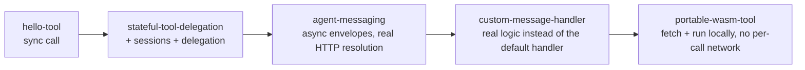

# AWP examples

Five self-contained, runnable programs, each `go run ./examples/<name>`
with no setup — no DNS, no real certificates, no other terminal window.
Every daemon they start is a real `internal/daemon.Daemon` (the type
`cmd/awpd` wraps) behind a real local TLS listener; nothing here is a
mock of the protocol, only of the network topology (DNS is a Go map
instead of a real record, and TLS certificates are self-signed instead of
WebPKI-issued).

Read them in this order — each one adds exactly one new concept on top of
the last:

| Example | Adds |
|---|---|
| [`hello-tool`](hello-tool) | The smallest complete exchange: a stateless sync tool, called via `sdk/go`. |
| [`stateful-tool-delegation`](stateful-tool-delegation) | Session lifecycle (`state: provider`) and delegation (acting on someone else's behalf). |
| [`agent-messaging`](agent-messaging) | The async side: two independent domains, signed envelopes, `message → ack → reply → close`. |
| [`custom-message-handler`](custom-message-handler) | Replacing the reference daemon's ack-then-reply default with your own logic — what it takes to be a real agent, not just a wire-format demo. |
| [`portable-wasm-tool`](portable-wasm-tool) | The other tool distribution path: fetch a manifest, download a pinned wasm binary, run it locally — no network call per invocation. |

## What's real, what's substituted

Every example is honest about the difference between the protocol
(real) and the local topology (substituted), and says so in its own
README. In short:

- **Signing, verification, and wire format are always real** — every
  signature in every example is checked by the same `internal/httpsig`,
  `internal/identity`, and `internal/delegation` code a production
  `awpd` uses. Corrupt a byte anywhere in these programs and the
  corresponding check fails exactly like it would in production.
- **TLS is always real** — `httptest.NewTLSServer` performs a genuine TLS
  handshake; only the certificate's trust chain (self-signed) is
  demo-only. Callers set `InsecureSkipVerify` to accept it, which is
  never something to do outside a local demo.
- **Key/index resolution ranges from "preloaded for simplicity" to
  "fully real HTTP fetch, DNS substituted"**, and each README says which.
  `agent-messaging` is the fullest version of this — see its README for
  why that matters and what a production deployment does instead
  (`internal/keyresolver.HTTPResolver`).

See [`docs/getting-started.md`](../docs/getting-started.md) for the
narrated version of `hello-tool`, and
[`docs/architecture.md`](../docs/architecture.md) for how the pieces these
examples use (`internal/daemon`, `internal/httpsig`, `internal/wasmrt`,
`sdk/go`) fit together.
