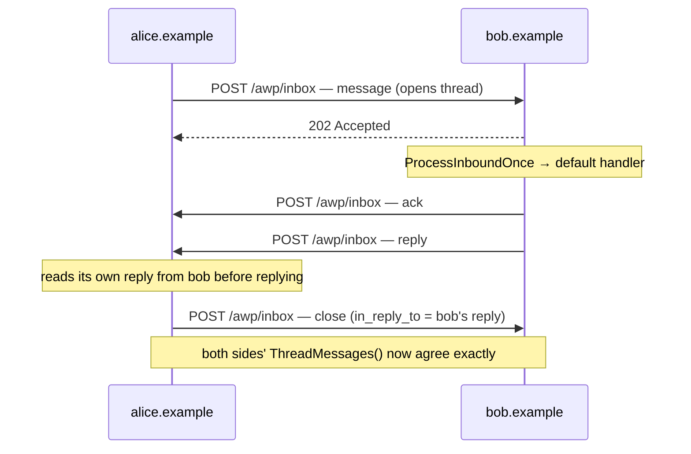

# agent-messaging

The async, agent-to-agent side of AWP: two independent domains,
`alice.example` and `bob.example`, each running a real `daemon.Daemon` —
the same type `cmd/awpd` wraps — exchange a signed `message`, get an
automatic `ack` and `reply`, and `alice` closes the thread. This is the
exact flow Phase 4's milestone criterion checks: *"message → ack → reply →
close, every signature verified, thread state correct on both sides."*

## Run

```
go run ./examples/agent-messaging
```

Both `alice`'s and `bob`'s final printed thread views should be identical:

```
  message from=alice.example    {"type":"text","text":"got a minute to review the AWP spec?"}
  ack     from=bob.example      {"type":"data","schema":null,"data":{}}
  reply   from=bob.example      {"type":"text","text":"received"}
  close   from=alice.example    {"type":"text","text":"thanks, that's everything"}
```



## What's happening

1. Each domain runs its own `daemon.Daemon`, `store.Store`, and keypair,
   behind its own `httptest.NewTLSServer` — two fully independent
   processes' worth of state, just sharing an address space for
   convenience.
2. **Key/inbox resolution is real HTTP fetching**, not a preloaded map
   like `hello-tool`/`stateful-tool-delegation` use — `httpResolver` in
   `main.go` fetches `/.well-known/awp.json` and verifies its
   self-signature exactly like `internal/keyresolver.HTTPResolver` does
   in production, just without its on-disk cache (fine for a handful of
   calls; a real daemon fetching on every signature check would be
   pointlessly slow). The only thing standing in for DNS is a Go map from
   domain name to local URL.
3. `alice.daemon.Send` signs and enqueues a `message`; `RunOutboxOnce`
   delivers it over a real signed HTTPS POST to bob's `/awp/inbox`.
4. `bob.daemon.ProcessInboundOnce` runs the reference default handler for
   an inbound `message` (`internal/daemon.handleMessage`): send an `ack`,
   then a `reply`. **A real agent plugs in its own logic here** — this
   daemon has no application behavior of its own; acking and replying is
   just how the reference implementation demonstrates the full envelope
   vocabulary end to end.
5. `drainOutbox` loops `RunOutboxOnce` until a tick delivers nothing. This
   isn't padding: `outbox.ProcessDue` deliberately starts at most one
   in-flight delivery per destination domain per call, so bob's `ack` and
   `reply` — both addressed to `alice.example` — land one tick apart. A
   real `awpd` never notices this because `cmd/awpd` calls `RunOutboxOnce`
   on a timer forever; a one-shot example has to loop to reach the same
   end state.
6. `alice` closes the thread with `in_reply_to` set to bob's `reply` id.
   Each side's own `store.Store` (`GetThread`/`ThreadMessages`) is queried
   directly to print what it independently recorded — no shared state,
   no shortcuts.

## Next

- [`hello-tool`](../hello-tool) and
  [`stateful-tool-delegation`](../stateful-tool-delegation) — the sync,
  request/response side of the protocol.
- [`docs/architecture.md`](../../docs/architecture.md) — how
  `internal/inbox`'s gate order and `internal/outbox`'s state machine work
  underneath `ProcessInboundOnce`/`RunOutboxOnce`.
