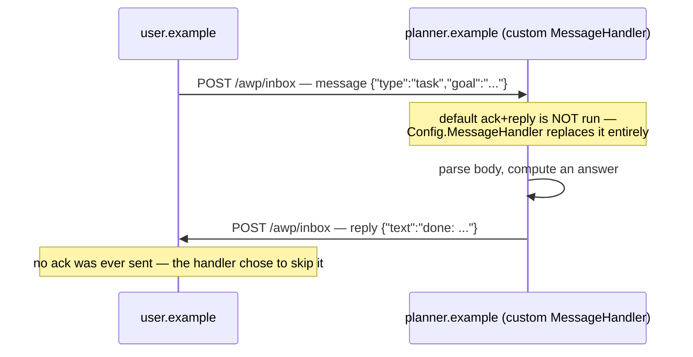

# custom-message-handler

The one thing [`agent-messaging`](../agent-messaging) deliberately leaves
out: real logic behind an agent's inbox.
`internal/daemon.Config.MessageHandler` replaces the reference default
(ack, then a fixed `"received"`) with a function you write — this is
what `docs/agent-guide.md`'s "being called" section means by "your agent
needs to actually decide what to reply."

## Run

```
go run ./examples/custom-message-handler
```

Expected output:

```
user -> planner   task    01k.......

user's view of the thread:
  message from=user.example     {"type":"task","goal":"book a table for four on friday"}
  reply   from=planner.example  {"type":"text","text":"done: BOOK A TABLE FOR FOUR ON FRIDAY"}

note: no `ack` anywhere above — the custom handler chose to skip it and reply directly.
```



## What's happening

1. `planner.example`'s daemon is constructed with
   `Config.MessageHandler` set to a function that parses the inbound
   `message` body, and — if it's a `task` — computes an answer and sends
   back exactly one `reply`. No `ack` at all: `send` (the callback a
   handler gets) can be called zero, one, or several times, in whatever
   order the handler's own logic decides; the reference default calling
   it exactly twice (ack, then reply) is just one policy among many.
2. `user.example` uses the *unmodified* default (`nil` handler) — it
   only ever sends and receives, never needs to auto-respond to
   anything itself.
3. Everything else — real signed HTTPS delivery, real HTTP index
   resolution between the two domains, `drainOutbox` looping past the
   per-domain-serial delivery limit — is identical to
   `examples/agent-messaging`; this example's only new idea is the
   handler itself.

## Why this matters

Before this hook existed, `internal/daemon`'s message handling was
hardcoded — there was no way to plug in real behavior short of editing
the package's own source. Every "agent" this reference implementation
could run was, underneath, the same ack-then-canned-reply stub. This is
the fix: a real agent's actual reasoning — call a tool, ask a
sub-agent, consult a model, whatever the task needs — belongs inside a
`MessageHandler`, called with the verified inbound envelope and a
`send` closure already addressed back to the right thread.

## Next

- [`agent-messaging`](../agent-messaging) — the same wire mechanics with
  the reference default handler, side by side for comparison.
- [`docs/agent-guide.md`](../../docs/agent-guide.md) — the "being
  called" section this example is the concrete answer to.
