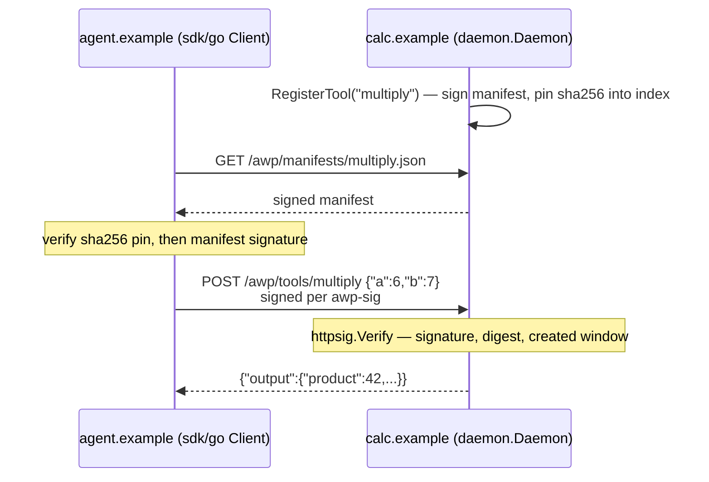

# hello-tool

The smallest complete AWP exchange: one domain publishes a signed manifest
for a stateless sync tool, a caller signs a request per `awp-sig-v0.1.md`,
and the provider verifies and executes it — all in one process, on an
ephemeral local port, with no DNS or real certificates required.

## Run

```
go run ./examples/hello-tool
```

Expected output:

```
tool output: {"computed_for":"agent.example","product":42}
```



## What's happening

1. `calc.example` runs a real `daemon.Daemon` (the same type `cmd/awpd`
   wraps) behind `httptest.NewTLSServer` — a genuine TLS handshake, just
   with a self-signed certificate instead of a WebPKI-trusted one.
2. It registers one tool, `calc.example#multiply`, via
   `daemon.RegisterTool` — this signs the manifest, serves it at
   `/awp/manifests/multiply.json`, and serves calls at
   `/awp/tools/multiply`.
3. `agent.example` is a bare keypair with no server of its own — just an
   `sdk/go` `awp.Client`. It calls `CallTool`, which resolves the
   manifest, verifies its `sha256` pin against the domain index, signs
   the request per awp-sig §1, and sends it.
4. `calc.example` verifies the request signature (`internal/httpsig`),
   runs the handler, and returns `{"product": 42, ...}`.

## What's simplified, and why

- **Key resolution is a hardcoded map (`staticResolver`), not real
  DNS+HTTPS.** `agent.example` never runs a server, so nothing could fetch
  its index anyway. A real deployment uses
  `internal/keyresolver.HTTPResolver`, which resolves and caches any
  domain's index over real HTTPS — see
  [`examples/agent-messaging`](../agent-messaging) for a demo where two
  full domains resolve each other for real, and
  [`docs/architecture.md`](../../docs/architecture.md) for how resolution
  fits together.
- **The TLS certificate is self-signed and untrusted on purpose** — that's
  what `httptest.NewTLSServer` gives you, and it's why the caller's
  `http.Client` sets `InsecureSkipVerify`. Never do that outside a local
  demo; `cmd/awpd -tls-cert/-tls-key` is the production path.

## Next

- [`stateful-tool-delegation`](../stateful-tool-delegation) — session
  lifecycle and calling on someone else's behalf.
- [`agent-messaging`](../agent-messaging) — the async, agent-to-agent side
  of the protocol.
