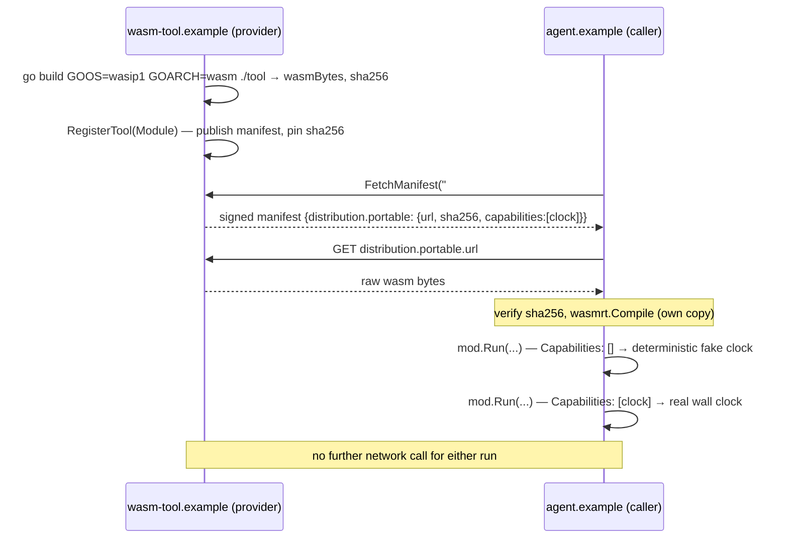

# portable-wasm-tool

AWP's other tool distribution path (core §1.2). `hello-tool` calls a
*hosted* tool — a network round trip per call, provider-executed.
"Portable" is the opposite: the caller fetches the manifest, downloads a
pinned wasm32-wasip1 binary, and runs it in its own sandbox. No network
call happens per invocation, and the caller — not the provider — decides
what capabilities (clock, random) the binary actually gets.

## Run

```
go run ./examples/portable-wasm-tool
```

Expected output (the first `observed_at` is always the same fixed value;
the second is the real time the command ran):

```
compiled ./tool -> ... bytes, sha256 ...

manifest declares capabilities: [clock]

running locally with no clock capability granted (host policy, despite the manifest's request):
  output: {"caller":"agent.example","char_count":43,"observed_at":"2022-01-01T00:00:00Z","word_count":9}

running locally with clock capability granted:
  output: {"caller":"agent.example","char_count":43,"observed_at":"2026-...Z","word_count":9}

note: no network call happened for either run above — that's the whole point of a portable tool.
```



## What's happening

1. `./tool/main.go` is a plain Go program that speaks stdio-json/1 (core
   §1.2) directly: read one JSON request from stdin, write one JSON
   response to stdout. It has no AWP-aware code in it at all — it would
   run under any stdio-json/1 host.
2. `main.go` cross-compiles it to `wasm32-wasip1` at run time
   (`GOOS=wasip1 GOARCH=wasm go build`) — the same thing
   `internal/wasmrt`'s own tests do to build their fixtures. There's no
   `.wasm` binary checked into this repo.
3. The provider publishes a manifest whose `distribution.portable` names
   a download URL, a `sha256`, and the capabilities the tool wants
   (`["clock"]`, since it reports the current time).
4. The caller calls `sdk/go`'s new `Client.FetchManifest` — the same
   pin-and-signature-verified fetch `CallTool` does internally, exposed
   directly for callers that don't want to make a sync call. It then
   downloads the binary from `distribution.portable.url` and checks its
   `sha256` itself, before `wasmrt.Compile` checks it again (defense in
   depth, the same spirit as a manifest's own pin being checked before
   its signature).
5. The caller compiles its **own** `wasmrt.Module` from the bytes it
   independently downloaded — never the provider's in-memory one — and
   runs it twice with different `wasmrt.Config{Capabilities: ...}`. The
   manifest's declared `["clock"]` is only ever a request; **the caller
   is the one holding the sandbox**, so it — not the provider, and not
   the manifest — decides what's actually granted. Withholding it doesn't
   error the call; it just makes `wasmrt`'s WASI clock a deterministic
   fake (`2022-01-01T00:00:00Z`, an arbitrary fixed epoch, not a missing
   import), which is exactly what a sandbox should do with an
   unauthorized capability request instead of failing loudly.

## Next

- [`hello-tool`](../hello-tool) — the *hosted* counterpart: a tool called
  over the network instead of run locally.
- [`docs/architecture.md`](../../docs/architecture.md) — how
  `internal/wasmrt` sandboxes a module and what "capability" means there
  precisely.
