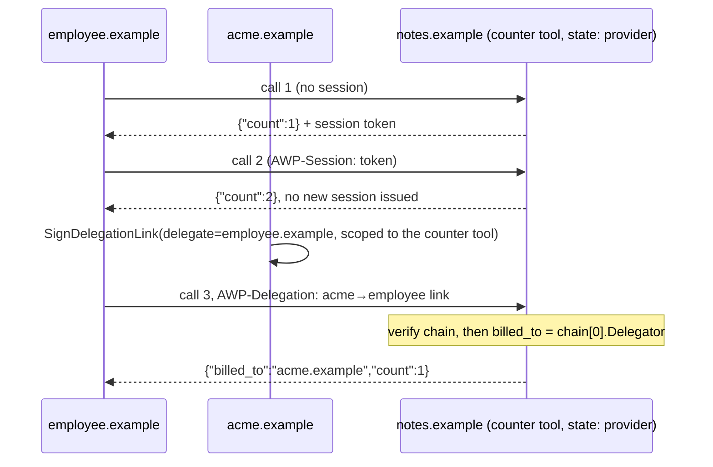

# stateful-tool-delegation

Two things `hello-tool` skips for simplicity: session lifecycle for a
`state: provider` tool (core §1.3), and delegation (core §2.5) — a caller
presenting a signed proof that it's acting on someone else's behalf.

## Run

```
go run ./examples/stateful-tool-delegation
```

Expected output:

```
1st call (no session yet):  {"billed_to":"employee.example","caller":"employee.example","count":1}
   -> issued session 01k....... (expires ...)
2nd call (reusing session): {"billed_to":"employee.example","caller":"employee.example","count":2}
3rd call (on acme's behalf): {"billed_to":"acme.example","caller":"employee.example","count":1}

note: employee.example signed all three calls, but the third is billed to acme.example — that's what the delegation chain proves.
```



## What's happening

1. `notes.example` hosts one `state: provider` tool, `#counter`. Per core
   §1.3, a provider-state tool issues a session token on a caller's first
   call and doesn't re-issue one as long as the caller keeps presenting a
   valid one.
2. `employee.example` calls it twice: the first response carries a fresh
   `session`; the second call sends `CallOptions{Session: ...}` and gets
   the same session back (no re-issuance) — `sdk/go`'s `CallTool` maps
   directly onto the `AWP-Session` request header / `session` response
   field core §1.3 defines.
3. `acme.example` — a domain that never calls the tool directly — signs a
   delegation link authorizing `employee.example` to act on its behalf,
   scoped to exactly this tool (`Scope.To`). `employee.example` attaches
   that link as `CallOptions.Delegation` on its third call.
4. The tool's handler receives both the verified signing caller
   (`employee.example`, from the HTTP signature) and the verified
   delegation chain. It attributes the call to `chain[0].Delegator`
   (`acme.example`) when a chain is present — this is the whole point of
   delegation: the entity that's cryptographically responsible for a call
   need not be the entity that technically sent the bytes.

The delegation chain itself is verified by `internal/httpsig.Verify`
before the handler ever runs (core §2.5: signature validity, continuity,
expiry, final-delegate match, scope intersection) — the handler only sees
chains that already passed every rule.

## Next

- [`agent-messaging`](../agent-messaging) — the async side of the
  protocol: no request/response, just signed envelopes and thread state.
- [`portable-wasm-tool`](../portable-wasm-tool) — the other tool
  distribution path, a wasm32-wasip1 module instead of a Go handler.
