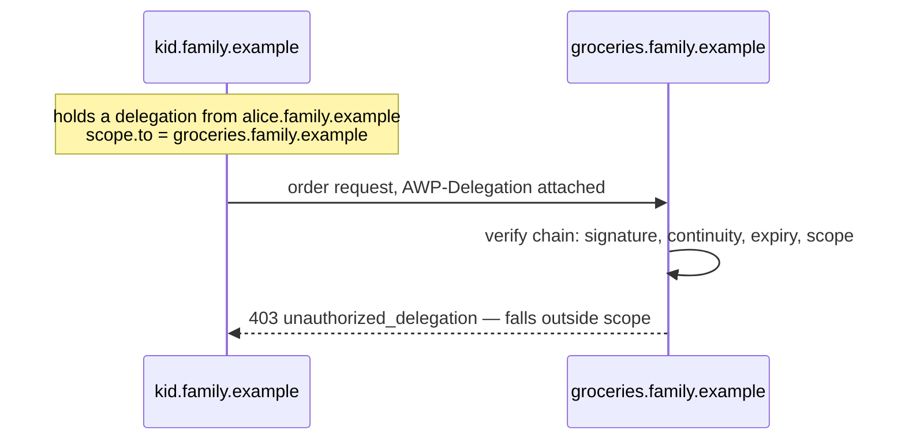
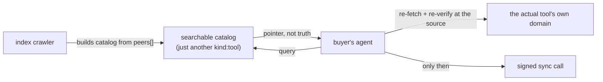
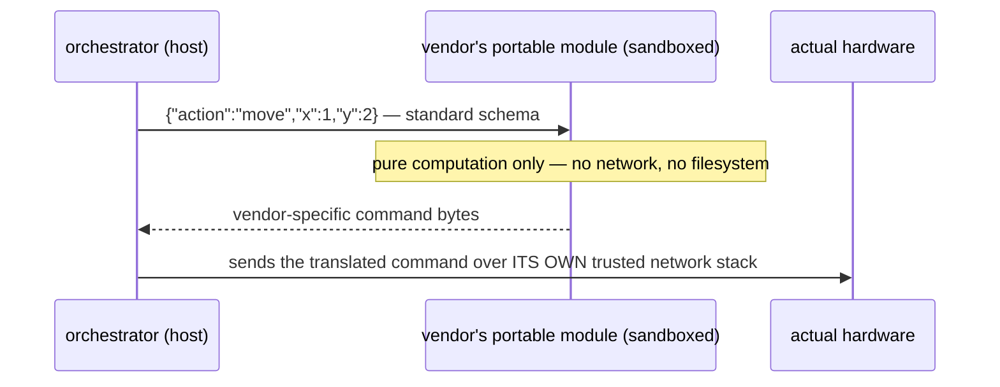
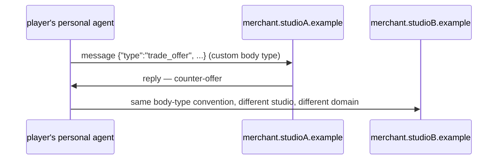
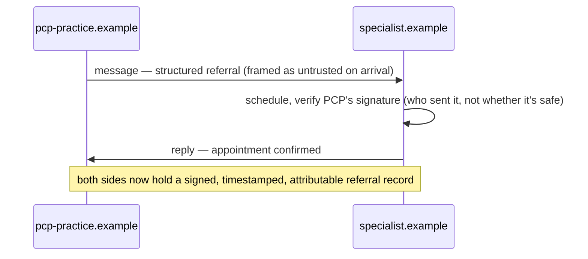

# Idea: four application sketches, and where v0.1 actually stops

**Status:** unreviewed brainstorm — not part of `spec/`, not ratified, not
implemented. Nothing here is normative. These are four deeper cuts from
a larger 100-item brainstorm of "things you could build on AWP"; picked
because each one surfaces a real, current limit of the protocol as
specified rather than just "an app that uses agents." Contrast with
`spec/*.md` (normative, in force) and `ideas/streaming.md` (a protocol
feature proposal) — this document is application-level, not a proposed
protocol change.

Each sketch below follows the same shape: the concrete scenario, the AWP
mechanism actually doing the work, a diagram, and — the point of writing
these down — exactly where v0.1 as specified stops short, so nobody reads
a diagram and assumes more capability than the protocol currently offers.

## Personal & household agents — spend-capped delegation for a household mesh

Each family member runs a personal agent at its own subdomain
(`alice.family.example`, `kid.family.example`), plus shared household
agents (`groceries.family.example`). A parent delegates to a kid's agent
with a scoped link; the kid's agent can only act within that scope — not
because an app enforces a policy, but because the delegation chain itself
can't authorize anything wider.

**Where v0.1 actually stops.** `delegation.Scope` (core §2.5) restricts
`to`/`kinds`/`body_types` — there's no numeric field for a dollar cap.
"Delegate authority to spend up to $50" isn't expressible in the wire
format today; `awp-core-v0.1.md` §7 lists "standardized scope
vocabulary" as explicitly deferred to v0.2. A real build today would
need the *tool itself* enforcing the cap out-of-band (real, just not a
protocol-level guarantee).

## Marketplaces & commerce — a marketplace that never trusts its own catalog

An index crawls the peer graph (`peers[]`, core §3) and publishes a
searchable catalog as an ordinary `kind:tool` entity. The interesting
part isn't the catalog — it's that a buyer's agent is *specified* to
never trust it: core §3 requires re-resolving and re-verifying every
listed principal against its own domain index before calling it, so a
compromised or lying index can point at the wrong URL but can't forge
what the tool's *own* signed manifest says.

**Where v0.1 actually stops.** The catalog's *query/submit schema*
(`awp-discovery-v0.1.md`) is explicitly marked strawman/provisional/
post-milestone-1 — there's no standardized cross-index query format yet.
What's solid today: manifest sha256 pinning (a listing can't silently
swap implementations) and untrusted-content framing on descriptions (a
malicious listing's text can't inject instructions into the buyer's
agent). A real prototype today would use a custom, non-standardized
search tool for the catalog itself, with verification-at-source being
the genuinely v0.1-ready piece.

## Robotics — portable WASM as protocol translators, not direct hardware control

A warehouse orchestrator commands forklifts, picking arms, and conveyors
from three different vendors. The tempting framing — "each vendor ships
a WASM module that drives the robot" — runs straight into a real
constraint: `internal/wasmrt`'s sandbox grants only `clock`/`random`;
network and filesystem are **not grantable in v0.1 at all** (core §1.2).
A WASM module can't open a socket to the robot no matter what the
manifest claims it needs.

The honest, still-genuinely-useful version: portable modules as
sandboxed **protocol translators** — sha256-pinned, swappable, safe to
run untrusted vendor code because it's mathematically incapable of doing
anything except transforming JSON. The host (not the module) does the
actual I/O. This pattern is real and buildable today; "WASM directly
drives the robot" is not.

## Gaming — a cross-studio economy needs its own body-type convention

A player's personal agent negotiates trades with an NPC agent in Game A
and, using the identical protocol, an NPC in Game B from an unrelated
studio — no shared backend, just mutual AWP support.

**Where v0.1 actually stops.** Core §2.3's registered body types
(`text`/`data`/`task`/`resource`/`multi`) have nothing game-specific. The
set is explicitly open, so a `trade_offer` type is allowed — but
"allowed" just means it won't be rejected as unknown; two studios would
need to independently agree on its shape, since there's no standards
body for it. The same spend-cap gap from the household sketch applies to
any "auto-trader" a player delegates to — scope can restrict *what tool*
it calls, not *how much* it's allowed to trade.

## Healthcare — referral routing gets you attributable transport, not compliance

A PCP's agent opens a thread with a specialist's scheduling agent to
hand off a referral; the specialist's intake process wraps the incoming
clinical text in untrusted-content framing before any LLM sees it (a
compromised PCP system's referral note can't prompt-inject the
specialist's own agent). Separately, a portable WASM formulary-check
tool runs entirely on the patient's device, so an insurance-benefit
lookup never sends a drug list anywhere.

**Where v0.1 actually stops, and this one matters most.** AWP gives you
sender authentication and tamper-evident transport — full stop. It says
nothing about HIPAA, BAAs, encryption-at-rest, or access logging, and
explicitly disclaims "authn ≠ content trust" as core security
philosophy, not an oversight (`awp-core-v0.1.md` §4). A real healthcare
deployment needs a large compliance layer that has nothing to do with
the protocol. Worth being direct about that distinction before anyone
reads "signed and verified" as "compliant."

## The recurring gap

Three of the four sketches above (household, gaming, and implicitly any
marketplace with spending agents) hit the same wall: **v0.1's delegation
scope can restrict *what* and *to whom*, never *how much***. A
standardized scope vocabulary with numeric/quantity constraints is
already named as v0.2-deferred (`awp-core-v0.1.md` §7) — this is
probably the single highest-leverage protocol extension implied by this
whole batch of application ideas, more so than streaming.

## Next steps (not started)

1. If a numeric scope vocabulary is worth designing now rather than
   waiting for v0.2, it deserves its own `ideas/` sketch — same
   treatment as `ideas/streaming.md`.
2. The marketplace sketch's "verify at source, never trust the catalog"
   pattern could be prototyped today with zero protocol changes — it's
   arguably the most immediately buildable idea in this document.
3. The robotics "portable module as protocol translator" pattern is also
   fully buildable today and would make a good addition to `examples/`
   or `agents/python/`, alongside the existing `portable-wasm-tool`
   example.
