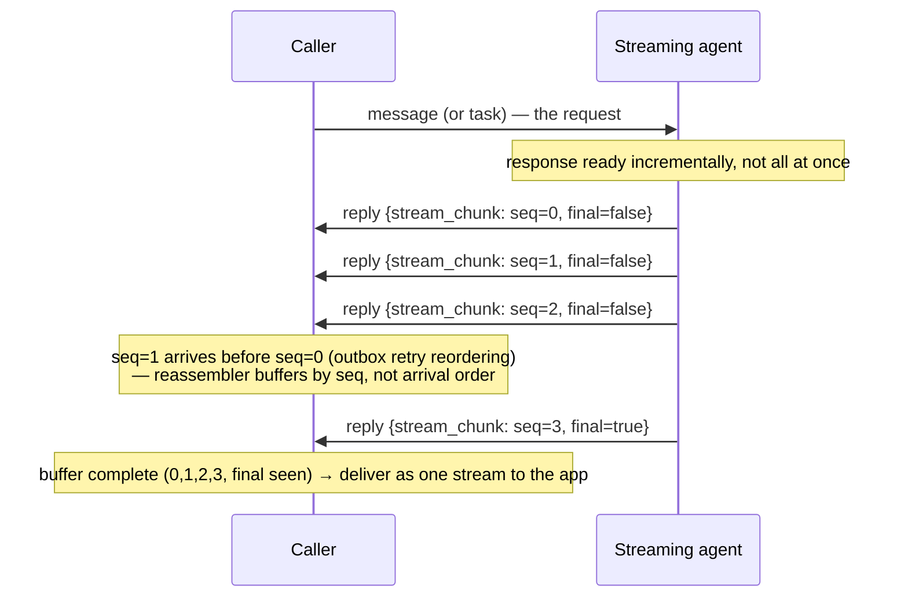
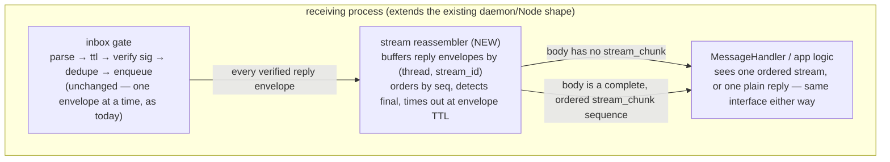
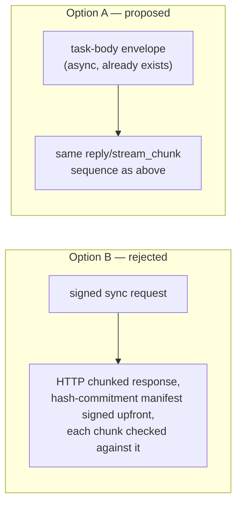

# Idea: streaming support in AWP

**Status:** promoted to [`spec/awp-streaming-v0.1.md`](../spec/awp-streaming-v0.1.md)
(draft). This document is kept as the design record — the open questions
in its final section are not all resolved by the spec doc, which took
the async-body-type approach and explicitly deferred the sync-call
question rather than answering it. Not yet implemented in `awpd` or
`pyawp`; the spec doc is normative text, this one is why it says what it
says.

## Why this exists

AWP has no streaming primitive anywhere today — not even a deferred one.
`spec/awp-quic-v0.1.md` §4's "stream model" is about QUIC *transport*
streams (one bidirectional stream per whole envelope, complete-message
framing); it isn't about incremental content delivery. Grepping the whole
`spec/` tree for "stream"/"chunk"/"SSE" turns up nothing else. It's not
listed among `awp-core-v0.1.md` §7's v0.2 backlog either — it simply
hasn't been considered, not even provisionally.

The core tension: `awp-sig` signs one complete message atomically
(`@status` + `content-digest` over the whole body, core §0.1's JCS
canonicalization over one complete object). Streaming wants to emit
content before the full body exists, which is in real tension with that
model — you either sign every chunk separately, or only the final
assembled response (leaving intermediate chunks unauthenticated until
the stream closes). This document proposes an approach that never
weakens per-message signing.

## Async (agent-to-agent) — the natural fit, proposed as-is

A "stream" is a sequence of ordinary, individually-signed `reply`
envelopes sharing a new body type. **No envelope-schema change at all** —
this is a body-type extension, and body types are already an open set
(core §2.3).

```json
{
  "type": "stream_chunk",
  "stream_id": "01j3z9...",
  "seq": 3,
  "final": false,
  "data": { "text": "...next chunk of content..." }
}
```

- `in_reply_to` on every chunk points at the *original request* envelope,
  not the previous chunk — chunks are siblings, not a chain.
- `seq` is required because delivery order isn't guaranteed (outbox
  retries can reorder chunks) — the same "receivers MUST NOT reject
  solely for out-of-order arrival" principle core §2.4 already states for
  ordinary envelopes, just now needing an actual reassembly buffer keyed
  by `stream_id`.
- `final: true` on some chunk ends the *stream*, not the *thread* — a
  stream is a sub-structure of a thread, not its lifecycle. `close` is
  unaffected and means what it already means.
- Every chunk is independently, fully signed per core §0.1. No "trust the
  stream, verify at the end" compromise — this is the property the whole
  design exists to preserve.
- **Backward-compatible for free**: an old receiver that doesn't
  understand `stream_chunk` already has a defined, correct response —
  `error(unsupported_body)` (core §2.3's existing rule), never a silent
  drop. No protocol version bump needed to introduce this.

### New bound needed

Alongside the existing 256 KiB envelope cap and the 8-link delegation
cap: a max chunk count per `stream_id`, enforced by the receiver, so a
broken or malicious streamer can't force unbounded reassembly-buffer
growth. A concrete number hasn't been picked; something generous but
finite (the existing caps' style: a fixed constant, not configurable —
"one fewer knob to misconfigure").

### Chunking granularity is policy, not protocol

Worth a spec-level SHOULD if this is ever written up for real: coalesce
to sentences/paragraphs/a time window, not one envelope per LLM token.
The signature-verification cost itself is cheap (sub-millisecond
Ed25519), but per-envelope overhead (headers, a full signature, HTTP
round-trip if not batched) makes token-level chunking wasteful regardless.

### The flow



### Where it would live in this codebase



The gate doesn't need to know streaming exists — it keeps doing exactly
what it does today, one envelope at a time, fully agnostic to body
content. The reassembler is a thin layer bolted on above it (in Go:
something new alongside `internal/inbox`, not a change to it; in
`pyawp`: a layer above `Node._process`, not a change to the gate in
`node.py`). On the sending side, `daemon.SendFunc` (Go) / `pyawp`'s
equivalent `send` closure would gain a thin `send_stream` convenience
that handles `seq`/`final` bookkeeping so a handler doesn't do it by hand.

## Sync (hosted tool calls) — recommend leaving alone



- **Option A (proposed): don't extend sync at all.** A tool that wants to
  stream is modeled as an async exchange — caller sends a `task` body
  (already exists, core §2.3), tool streams back `reply` envelopes using
  exactly the mechanism above. One streaming mechanism total, not two;
  `awp-sig` and hosted sync calls stay exactly as simple as they are
  today.
- **Option B (considered, not recommended):** HTTP-native chunked
  streaming backed by a Merkle-style hash-commitment list signed upfront,
  with each streamed chunk checked against it as it arrives. Technically
  workable, but a materially bigger addition — closer to a v2 protocol
  feature than a v0.1-shaped extension, and in real tension with
  `awp-sig`'s explicit "no negotiation, no algorithm agility" design
  philosophy (see `spec/awp-sig-v0.1.md`'s own framing).

## Open questions if this moves forward

- Exact max-chunks-per-stream constant, and whether it should differ by
  `kind` (tool response vs. long-running agent task).
  <br>
- Whether a receiver that never sees a `final: true` chunk (sender died
  mid-stream) should synthesize its own local "stream aborted" signal at
  TTL expiry, and whether that needs a wire-visible envelope at all or is
  purely a receiver-side concern.
- Whether `stream_id` should be sender-minted (like `thread`/envelope
  `id`, a ULID) or deterministically derived from the request envelope's
  own `id` (simpler, but couples one request to at most one concurrent
  stream — probably fine, since `in_reply_to` already implies that).
- Whether this belongs as an addendum to `awp-core-v0.1.md` §2.3, or as
  its own `spec/awp-streaming-v0.1.md` — leaning toward the latter, on
  the theory that `awp-quic` already sets the precedent of "optional
  capability gets its own document, referenced from core."

## Next steps (not started)

1. Write `spec/awp-streaming-v0.1.md` properly, RFC 2119 style, if this
   gets ratified as a real decision rather than staying an idea.
2. Prototype the reassembler in `internal/inbox` (Go) and `pyawp/node.py`
   (Python) — same shape in both, per this repo's existing habit of
   cross-checking the two against each other
   (`agents/python/scripts/crosscheck_go.py`).
3. Add a `stream_chunk` example to `examples/` or `agents/python/`
   showing an LLM response streamed over async envelopes end to end.
