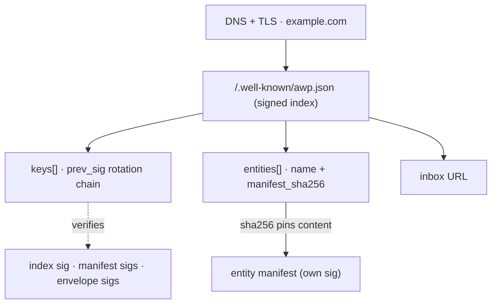
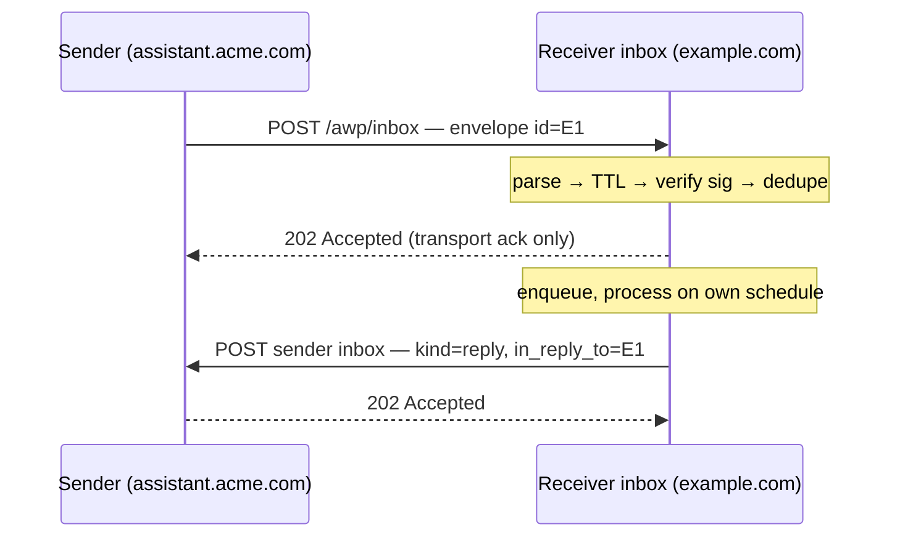
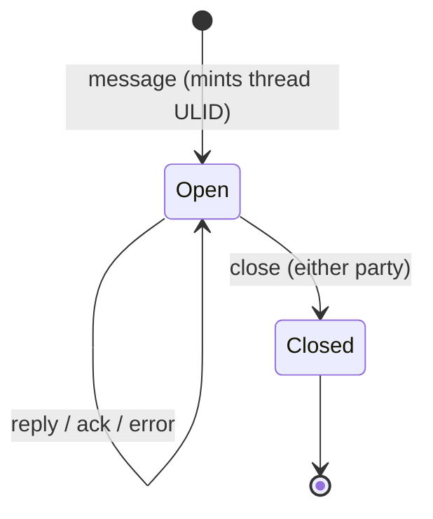
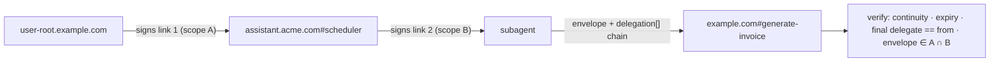

# AWP Core v0.1 — Manifest Layer and Wire Format

**Status:** draft. Normative keywords (MUST, SHOULD, MAY) per RFC 2119.
**Scope:** L0 naming/identity, L2 manifests (Part 1), L1 async wire format
(Part 2). The sync signing profile is normatively defined in `awp-sig-v0.1.md`
and referenced here as §2.6.

## 0. Conventions and terminology

- All JSON documents are UTF-8. Signing canonicalizes with **JCS (RFC 8785)**.
- All signatures are **Ed25519**; values base64url, unpadded (RFC 4648 §5).
- All ordering-sensitive IDs are **ULIDs**, lowercase Crockford base32.
- Timestamps are RFC 3339 UTC, millisecond precision: `2026-07-21T09:14:03.512Z`.
- **Principal name**: `{domain}` or `{domain}#{entity}`
  (e.g. `invoicer.example.com#generate`). The fragment names an entity within
  a domain; the bare domain names the operator. `domainOf(principal)` strips
  the fragment. Grammar (ABNF):

  ```abnf
  principal = domain ["#" entity]
  domain    = <RFC 1035 domain, lowercase, no trailing dot>
  entity    = slug
  kid       = slug
  slug      = lowalnum *62(lowalnum / "-") [lowalnum]   ; 1-64 chars,
  lowalnum  = %x61-7A / DIGIT                            ; no lead/trail "-"
  ```

  Comparison is byte-wise after lowercasing the domain; entity and kid are
  case-sensitive by grammar (lowercase-only), so no folding ever applies.
  Parsers MUST reject anything outside this grammar — no percent-encoding,
  no Unicode, no IDN in v0.1 (punycode the domain first).
- **Entity**: anything published — a tool, app, or agent.
- **Domain index**: the signed root document at `/.well-known/awp.json`.
- **Envelope**: the unit of async communication (§2.1).
- **Thread**: a set of envelopes sharing a `thread` ULID (§2.4).

### 0.1 Signature construction (used by index, manifest, envelope, delegation link)

To sign object `O`: remove the `sig` member, serialize, apply JCS, sign the
resulting bytes with Ed25519, attach `"sig": {"kid": ..., "value": base64url}`.
To verify: resolve `(domain, kid)` via the signer's domain index, rebuild the
canonical bytes identically, verify. Verifiers MUST re-fetch the signer's index
once on failure before hard-failing (rotation race), then reject.

---

## Part 1 — Manifest layer

### 1.1 Domain index

Every participating domain MUST serve
`https://{domain}/.well-known/awp.json` over TLS.

```json
{
  "awp": "0.1",
  "domain": "example.com",
  "updated": "2026-07-21T09:00:00.000Z",
  "keys": [
    {
      "kid": "2026-07-01",
      "alg": "ed25519",
      "pub": "base64url-raw-32-bytes",
      "created": "2026-07-01T00:00:00.000Z",
      "expires": null,
      "revoked": false,
      "prev_sig": null
    }
  ],
  "entities": [
    {
      "name": "example.com#generate-invoice",
      "kind": "tool",
      "manifest": "https://example.com/awp/manifests/generate-invoice.json",
      "manifest_sha256": "hex"
    }
  ],
  "inbox": "https://example.com/awp/inbox",
  "peers": ["acme.com", "toolmaker.dev", "index.awp.dev"],
  "crawl": true,
  "transports": [ { "proto": "awp/1", "endpoint": "example.com:8443" } ],
  "sig": { "kid": "2026-07-01", "value": "base64url" }
}
```

Rules:

1. `keys` MUST contain ≥1 non-revoked key. Multiple active keys are permitted
   (rotation overlap).
2. **Rotation.** A new key's `prev_sig` MUST be the Ed25519 signature of the
   new key's raw `pub` bytes by the previously active key. A verifier accepts
   a key iff the rotation chain from a previously trusted key verifies at
   every link. A domain that loses all keys restarts with no continuity;
   clients MUST treat this as a new identity (TOFU reset, surfaced to the
   operator, never silent).
3. **Revocation and expiry.** To revoke: set `revoked: true`, keep the
   entry. Signatures by a revoked key MUST be rejected when the signed
   object's timestamp postdates the revocation; MAY be accepted when it
   predates it (verifier policy). `expires`, when non-null, behaves as an
   automatic revocation at that instant under the same postdates/predates
   rule — expiry needs no index update, which is the point: a lost-but-
   expiring key bounds the damage window even if the operator never notices.
4. `sig` covers the JCS form of the index minus `sig` (§0.1).
5. Domain-level `inbox` is the default for all entities; an entity manifest
   MAY override.
6. **Caching.** Serve with `Cache-Control` (and SHOULD support `ETag`).
   Clients SHOULD honor cache headers and MUST perform the one-refresh retry
   of §0.1 before treating a signature as invalid.
7. **Peers.** `peers` is an OPTIONAL array of bare domains the operator
   asserts *exist and speak AWP* — existence-vouching, never endorsement of
   conduct or quality. ≤ 100 entries; bare domains only (no principals, no
   URLs); no self-reference; duplicates invalid. Being listed in someone
   else's `peers` requires no consent and confers no obligation. Signed with
   the index, so a domain's public edge set is attributable to it.
8. **Crawl consent.** `crawl` (OPTIONAL, default `true`) — when `false`,
   indexes MUST NOT serve this domain's entities in search results and
   SHOULD NOT traverse its `peers`. The domain remains directly resolvable
   and referrable: `crawl: false` means private-but-federated (reachable by
   name, invisible to search), not offline.



### 1.2 Entity manifest

One signed JSON document per entity, referenced from the index with a content
hash — the index signature transitively covers every manifest; a swapped
manifest fails `manifest_sha256` before its own signature is checked.

```json
{
  "awp": "0.1",
  "name": "example.com#generate-invoice",
  "kind": "tool",
  "version": "1.2.0",
  "updated": "2026-07-20T18:00:00.000Z",
  "description": "Generates a PDF invoice from line items. Accepts ILS/USD/EUR. Returns a URL valid for 24h. Refuses totals above 100k without an approval reference.",
  "io": {
    "input":  { "$schema": "https://json-schema.org/draft/2020-12/schema", "type": "object" },
    "output": { "$schema": "https://json-schema.org/draft/2020-12/schema", "type": "object" }
  },
  "distribution": {
    "hosted":   { "endpoint": "https://example.com/awp/tools/generate-invoice" },
    "portable": {
      "url": "https://example.com/awp/pkg/generate-invoice-1.2.0.wasm",
      "sha256": "hex",
      "runtime": "wasm32-wasip1",
      "interface": "stdio-json/1",
      "capabilities": []
    }
  },
  "state": "stateless",
  "auth": { "sig": "required", "scopes": [] },
  "pricing": null,
  "inbox": null,
  "sig": { "kid": "2026-07-01", "value": "base64url" }
}
```

Field semantics:

| Field | Semantics |
|---|---|
| `kind` | `tool` / `app` / `agent` — selects interaction semantics (§1.4). |
| `version` | Semver of the entity. Breaking I/O changes MUST bump major. `awp` versions the protocol independently. |
| `description` | **Normative interface surface, not documentation.** Agents select capabilities by reading it. MUST state what the entity does, meaningful constraints/refusal conditions, and units/currencies/formats wherever ambiguity is possible. Verifiers MAY reject empty descriptions. |
| `io` | JSON Schema 2020-12. For `kind: agent`, describes structured thread-body conventions and MAY be omitted (free-form conversation). |
| `distribution` | ≥1 of `hosted` / `portable` MUST be present. |
| `state` | `stateless` / `provider` / `caller` (§1.3). |
| `auth.sig` | `required` — always, in v0.1. `scopes` reserved. |
| `pricing` | MUST be `null` in v0.1. Reserved for v0.2 economics. |
| `inbox` | Per-entity override of the domain inbox, or `null`. |

**Portable runtime profile (`stdio-json/1`).** v0.1 pins exactly one:
`wasm32-wasip1`; the module reads one JSON request from stdin, writes one JSON
response to stdout, exits 0. The exact I/O contract:

```json
// stdin — exactly one document, then EOF
{
  "awp": "0.1",
  "caller": "assistant.acme.com#scheduler",
  "session": null,
  "input": { }
}
// stdout — exactly one of:
{ "output": { } }
{ "error": { "code": "refused", "detail": "...", "retryable": false } }
```

`input` conforms to the manifest's `io.input` schema; `output` to
`io.output`. The wrapper exists because the module deserves to know who is
asking — `caller` is the verified principal, `session` the provider token if
any. Exit code 0 with a valid stdout document is the ONLY success; nonzero
exit, empty stdout, or unparseable stdout are all host-side
`error(internal)`. Anything the module writes to stderr is host log material,
never returned to the caller. Grantable capabilities: `"clock"`, `"random"`.
Network and filesystem are NOT grantable in v0.1. Hosts MUST enforce the
declared capability list by construction (unbacked WASI imports, not stubs);
absent clock/random makes execution deterministic by default. Hosts MUST
verify `sha256` of the fetched module before execution and SHOULD impose an
execution timeout (reference: 30 s). Component-model/WIT is deferred to v0.2;
`stdio-json/1` is deliberately dumb and universally implementable.

### 1.3 Sessions (`state: provider`)

- `stateless`: every call independent.
- `caller`: caller ships full context each call; provider MUST NOT persist
  per-caller state.
- `provider`: the first sync call returns

```json
{ "session": { "token": "opaque", "expires": "2026-07-21T10:00:00.000Z", "sid": "ulid" } }
```

Caller passes the token on subsequent calls: `AWP-Session` header (sync) or
`session` envelope field (async). Tokens are opaque to callers; providers
SHOULD make them self-authenticating rather than DB lookups. RECOMMENDED
construction:

```
token = base64url(JCS({"sid": ulid, "caller": principal,
                        "entity": principal, "expires": rfc3339}))
        "." base64url(ed25519_sig_by_provider_domain_key)
```

Verification is then: decode, check expiry, check `caller` equals the
request's verified signing principal, verify the signature with the
provider's own current key — no storage read on the hot path. Callers MUST
still treat the token as opaque bytes. Session
scope is the pair *(caller principal, entity)*: a token presented under a
different signing principal MUST be rejected — sessions do not transfer;
delegation (§2.5) exists for acting on another's behalf.

### 1.4 Interaction semantics by kind

- `tool` → one sync request/response against `hosted.endpoint`
  (per `awp-sig-v0.1.md`), or one `stdio-json/1` execution of the portable
  package.
- `app` → tool transport + session lifecycle per `state`.
- `agent` → async envelopes to the entity's inbox, organized in threads
  (Part 2). An agent that also offers tools publishes them as separate
  entities — the manifest graph, not endpoint multiplexing, expresses
  composition.

---

## Part 2 — Wire format: envelopes, inboxes, threads

### 2.1 Envelope

```json
{
  "awp": "0.1",
  "id": "01j3z8k9x2m4q5r6s7t8u9v0w1",
  "kind": "message",
  "from": "assistant.acme.com#scheduler",
  "to": "example.com#generate-invoice",
  "thread": "01j3z8k0a1b2c3d4e5f6g7h8j9",
  "in_reply_to": null,
  "ts": "2026-07-21T09:14:03.512Z",
  "ttl": 3600,
  "session": null,
  "delegation": [],
  "body": { "type": "text", "text": "..." },
  "sig": { "kid": "2026-07-01", "value": "base64url" }
}
```

| Field | Rules |
|---|---|
| `id` | Sender-generated ULID; globally unique per sender; the idempotency key. |
| `kind` | `message` / `reply` / `error` / `ack` / `close` (§2.4). |
| `from` / `to` | Principal names. `domainOf(from)` selects the index that verifies `sig`. |
| `thread` | ULID minted by the sender of the thread's first envelope; reused by all subsequent envelopes in the conversation. |
| `in_reply_to` | Envelope `id` being responded to; `null` for openers and unsolicited follow-ups. |
| `ts` | Sender clock at send. |
| `ttl` | Seconds from `ts` after which the envelope is void. Bounds: `60 ≤ ttl ≤ 604800`. Receivers MUST NOT process expired envelopes nor ack them as processed. |
| `session` | Provider session token or `null`. |
| `delegation` | Ordered proof chain (§2.5), possibly empty. |
| `body` | Typed content (§2.3). |
| `sig` | Per §0.1, by a non-revoked key of `domainOf(from)`. |

**Size limit:** serialized envelope ≤ 256 KiB. Larger payloads travel by
reference (`resource` body).

### 2.2 Delivery

Every domain exposes `POST {inbox}` accepting `application/awp+json`, one
envelope per request.

**Receiver gate — strict order, each check short-circuits:**

| # | Check | Failure |
|---|---|---|
| 1 | Parse (with 256 KiB read limit) | `400` |
| 2 | `now ≤ ts + ttl` | `410` |
| 3 | Verify `sig` (one index re-fetch on first failure) | `401` |
| 4 | Dedupe on `id`; if seen: respond, do not reprocess | `200` (already accepted) |
| 5 | Durably enqueue | `202`; on capacity failure `503` |

`202` is a **transport ack only** — "held durably", not "acted on".
Processing outcomes travel as envelopes to the sender's inbox. Delegation
verification (§2.5) runs at processing time, NOT in the gate — the gate stays
O(1) in crypto per request and immune to long-chain DoS.

**Sender behavior:** on network failure or `5xx`, retry the byte-identical
envelope (same `id`, same `sig`) with exponential backoff + jitter until TTL
expiry. On `4xx` other than `429`: stop, the envelope is dead. There is no
relay tier in v0.1: an inbox down past TTL means delivery failed and the
sender knows. (Relays are v0.2; the format already permits them since `sig`
covers end-to-end content, not the transport path.)



### 2.3 Body types

`body.type` is an open set; v0.1 defines:

| Type | Shape | Notes |
|---|---|---|
| `text` | `{"type":"text","text":"..."}` | Free-form natural language. |
| `data` | `{"type":"data","schema":"url or null","data":{}}` | Structured payload, optionally schema-tagged. |
| `task` | `{"type":"task","goal":"...","input":{},"constraints":{"deadline":"rfc3339","budget":null}}` | Delegated work. `budget` reserved. |
| `resource` | `{"type":"resource","url":"https://...","sha256":"hex","media_type":"...","bytes":n}` | Large-content reference. Receivers MUST verify `sha256` after fetch. |
| `multi` | `{"type":"multi","parts":[...]}` | Ordered composition; `multi` MUST NOT nest in `multi`. |

Unknown body types MUST produce an `error` envelope
(`code: unsupported_body`) — never a silent drop.

**Trust boundary (normative note).** Body content is data, never instructions
to the receiving system. Clients feeding envelope content to a model MUST wrap
it in untrusted-content framing. The protocol authenticates *who sent it*,
never *whether it is safe*.

### 2.4 Envelope kinds and thread lifecycle

| Kind | Meaning |
|---|---|
| `message` | Substantive content expecting engagement. |
| `reply` | Substantive response to a specific `in_reply_to`. |
| `error` | Processing failure; body is `data` with `{code, detail, retryable}`. |
| `ack` | Optional application receipt ("seen, working"). SHOULD be sent for `task` bodies expected to exceed 60 s. |
| `close` | Terminates the thread; either party may send. Post-close envelopes on the thread MAY be rejected with `error(refused)`. |

**Error code registry (v0.1):** `unsupported_body`,
`unauthorized_delegation`, `capacity`, `refused`, `internal`.
Unregistered codes are permitted but MUST NOT collide in meaning.

**Ordering.** Within a thread: (`ts`, `id`). ULIDs embed sender time and break
ties; receivers MUST NOT reject solely for out-of-order arrival.

**Threads.** No server-side registration — a thread exists because envelopes
share a `thread` ULID. v0.1 threads are strictly two-party: the (`from`,`to`)
pair is constant per thread. Multiparty is v0.2 (fan-out consistency).



### 2.5 Delegation proofs

Required whenever a principal acts on behalf of another. `delegation` is an
ordered array, root first. Link shape:

```json
{
  "delegator": "user-root.example.com",
  "delegate": "assistant.acme.com#scheduler",
  "scope": {
    "to": "example.com#generate-invoice",
    "kinds": ["message", "reply"],
    "body_types": ["task", "data"]
  },
  "expires": "2026-07-21T18:00:00.000Z",
  "nonce": "ulid",
  "sig": { "kid": "...", "value": "base64url" }
}
```

Validity rules:

1. Each link's `sig` is by the `delegator`'s domain key over the JCS link
   minus `sig` (§0.1).
2. Continuity: link *n*'s `delegate` == link *n+1*'s `delegator`.
3. Every link unexpired at verification time.
4. Final `delegate` == the envelope's `from` (or, for sync, the principal
   derived from the signing `keyid`).
5. The envelope MUST fall within the **intersection** of all scopes. Absent
   scope fields mean unrestricted *for that field*; an entirely empty root
   scope is invalid — **root links MUST either scope `to` or carry
   `expires ≤ 24 h`** (an unscoped eternal root delegation is a stolen-key
   amplifier).
6. Chains MUST NOT exceed 8 links (bounded verification cost).
7. Failures produce `error(unauthorized_delegation)` (async) or `403` (sync).



### 2.6 Sync calls: signing and errors

Signing is normatively defined in `awp-sig-v0.1.md`.

**Error responses.** Any sync `4xx`/`5xx` with a body MUST use
`application/awp+json` with the same shape as the async error body:

```json
{ "error": { "code": "refused", "detail": "human-readable", "retryable": false } }
```

Codes come from the §2.4 registry plus the transport-level codes implied by
`awp-sig` (`unauthorized_delegation` on `403`, etc.). A bodyless `4xx`/`5xx`
is permitted (status code alone), but a body in any other shape is a
conformance violation — one error grammar across sync and async means one
error handler in every client.

---

## 3. Discovery

Four mechanisms, layered:

1. **Direct resolution** — a known principal name resolves via DNS →
   `/.well-known/awp.json` → manifest. Config-time wiring and human-supplied
   names.
2. **Referral** — principal names passed in envelope bodies and manifests.
   Globally resolvable and self-verifying, so a referral is complete with no
   introduction ceremony. Referrals are private edges.
3. **Crawl graph** — the `peers` field (§1.1 rule 7) is the public edge set.
   Crawlers seed with any known domains and traverse `peers` transitively,
   exactly as hyperlinks made HTML crawlable. Peer in-degree is a verifiable
   (though gameable — see §4) popularity signal.
4. **Indexes** — search over the crawled corpus, published as ordinary AWP
   `tool` entities with a standardized query/result schema
   (`awp-discovery-v0.1.md`, forthcoming), so agents can use and cross-check
   any index interchangeably. Results are pointers, not truth: agents MUST
   resolve and verify returned principals against the target's own domain
   index before use.

The protocol defines the crawlable format, not the index. Anyone MAY run a
crawler and serve a search API; the index role is competitive, the publishing
format is standard.

**Crawler conduct** (normative for anything calling itself an AWP index):
honor `Cache-Control`/`ETag`; verify every signature before serving derived
results; drop domains whose index fails verification rather than serving
stale-but-broken data; honor `crawl: false` per §1.1 rule 8; SHOULD re-crawl
on a cadence proportional to observed change rate; MUST NOT fabricate edges —
a domain appears in the graph only via its own `peers` assertions or direct
submission.

## 4. Security considerations

- **Authn ≠ content trust.** Signatures prove origin, nothing else. Prompt
  injection via descriptions, bodies, and manifests is the consuming client's
  problem by explicit design decision; reference clients MUST apply
  untrusted-content framing (§2.3).
- **Key loss** is identity loss (§1.1 rule 2) — deliberate; recovery schemes
  are where federated identity designs rot.
- **Squatting / index SEO** is unmitigated in v0.1; delegation scoping plus
  domain reputation are the only levers. Acknowledged, deferred.
- **Peer-graph gaming.** `peers` in-degree is Sybil-able — registering N
  domains that all list each other is cheap. Indexes MUST treat in-degree as
  a weak signal, weight edges by the age/verifiability of the *asserting*
  domain, and never use raw in-degree as a primary ranking. (Same lesson as
  PageRank vs link farms; domains cost money, which helps but does not
  solve.)
- **DoS surfaces**: gate is O(1) crypto; delegation chains capped at 8 and
  verified post-ack; envelopes capped at 256 KiB; portable modules run
  network-less, capability-gated, and time-limited.
- **Replay**: envelope `id` dedupe within TTL (receivers MUST retain seen-ids
  ≥ the longest TTL they accept); sync replay is bounded by the ±300 s
  `created` window in `awp-sig`.

## 5. Conformance checklist (v0.1 receiver)

1. Serves a valid signed domain index over TLS with ≥1 active key.
2. Gate checks in §2.2 order with specified status codes.
3. Retains seen-ids ≥ max accepted TTL.
4. Verifies delegation per §2.5 before acting on delegated envelopes.
5. Emits `error` envelopes for unknown body types.
6. Never processes expired envelopes.
7. Enforces the two-party thread invariant.

## 6. Transport policy

HTTPS is the mandatory transport floor: every implementation MUST speak it,
and all normative behavior in this spec is defined over it. This is
deliberate — HTTP over 443 is the only protocol that reliably traverses
firewalls, NATs, ingress, and CDNs, and the spec leans on HTTP semantics
throughout (RFC 9421, Content-Digest, status codes, cache headers,
`.well-known` bootstrap). Negotiated upgrades are permitted: `awp/1`
over QUIC is defined in `awp-quic-v0.1.md` — envelope delivery only,
advertised via the signed index `transports` field, with mandatory HTTPS
fallback and gate equivalence. This is the HTTP/1→2→3 playbook: upgrade
inside the deployable envelope, never fork out of it. A raw-TLS
*replacement* transport remains explicitly rejected.

The `awp://` URI scheme is agent-native *addressing*
(`awp://invoicer.example.com#generate`; grammar in `awp-quic` §6): naming,
not plumbing — it always resolves via DNS → `.well-known` (HTTPS) →
manifest, and never implies a particular transport.

## 7. Deferred to v0.2

Multiparty threads · store-and-forward relays · WASM component-model
interface · pricing/settlement · standardized scope vocabulary ·
content-trust / provenance labels beyond sender authentication.
