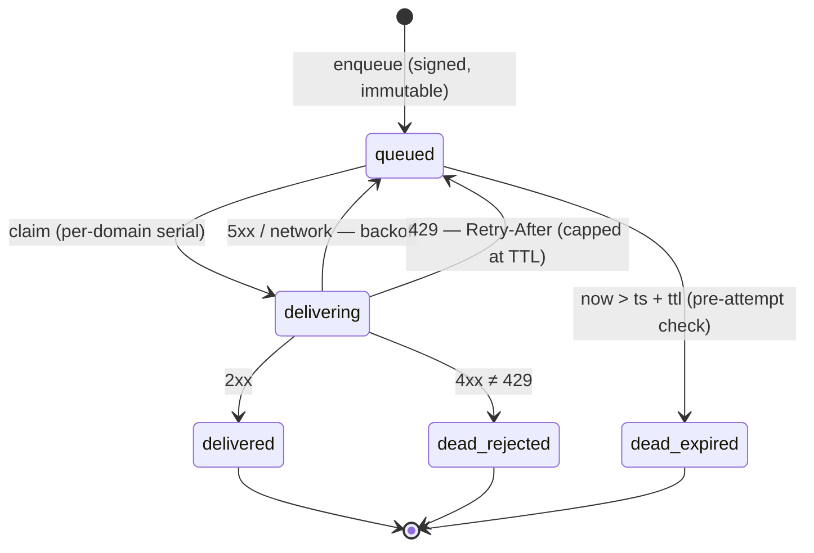

# awpd Outbox v0.1 — Delivery Retry State Machine

**Status:** draft. Implementation spec for the reference daemon. The
observable wire behavior (retry-same-bytes, TTL respect, 4xx handling) is
protocol-obligated **[P]** via core §2.2; the machine itself is `awpd`'s.

## 1. States

`queued → delivering → delivered | queued (retry) | dead(reason)`

Terminal: `delivered`, `dead(expired)`, `dead(rejected: code)`.

## 2. Rules

1. **Pre-attempt expiry check [P].** Before every attempt:
   `now > ts + ttl → dead(expired)`. Never send an envelope the receiver is
   obligated to `410`.
2. **Backoff** — full jitter:
   `next_at = now + rand(0, min(cap, base · 2^attempts))`, base 1 s,
   cap 300 s. `attempts` increments only on failure.
3. **429**: honor `Retry-After` when present and ≤ remaining TTL; otherwise
   treat as 5xx.
4. **Same bytes every attempt [P].** The envelope is immutable after signing —
   same `id`, same `sig`, same serialization. Receiver dedupe (gate 4) is
   what makes at-least-once safe. The outbox MUST NOT re-sign or
   re-timestamp.
5. **Per-domain serial delivery.** One in-flight request per destination
   domain; a global worker pool across domains (concurrency bounded by
   config, not by the machine). Preserves intra-thread arrival ordering in
   the common case and is automatically polite to a struggling receiver.
6. **Crash recovery.** On boot: all `delivering → queued`, `next_at = now`.
   With rule 4, a crash mid-request is indistinguishable from a network
   failure.
7. **Dead letters are kept.** `dead` records persist until explicit GC
   (config `outbox.dead_retention`, default 30 d) so
   `awp outbox ls --dead` answers "what failed and why". `dead` is also the
   seam where a v0.2 relay tier plugs in without touching this machine.
8. **Failure reporting.** `dead` transitions for envelopes of kind `reply` /
   `error` are logged only. For `message` / `task`, the daemon surfaces the
   failure to the local caller (CLI exit code / registered callback) — never
   as a synthetic inbound envelope. The protocol has no delivery-status
   kind in v0.1 by design: DSN loops killed email; we don't import them.

## 3. Configuration

| Key | Default | Meaning |
|---|---|---|
| `outbox.workers` | 8 | Global delivery concurrency (across domains). |
| `outbox.backoff_base` | 1s | Rule 2 base. |
| `outbox.backoff_cap` | 300s | Rule 2 cap. |
| `outbox.dead_retention` | 720h | Rule 7 GC horizon. |
| `outbox.request_timeout` | 30s | Per-attempt HTTP timeout. |

## 4. Observability

Counters: `delivered_total`, `dead_total{reason}`, `attempts_total`,
`retry_after_honored_total`. Gauges: `queued`, `delivering`, per-domain
in-flight. Every state transition logs `{id, to_domain, state, attempts,
last_err}` at debug; `dead` at warn.
